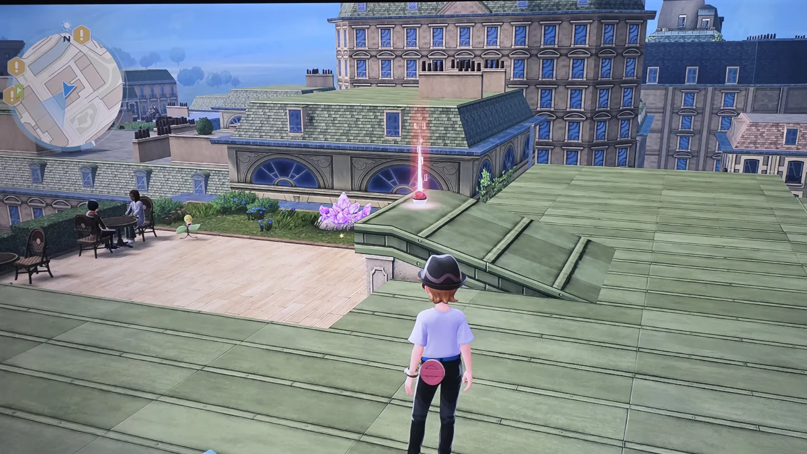
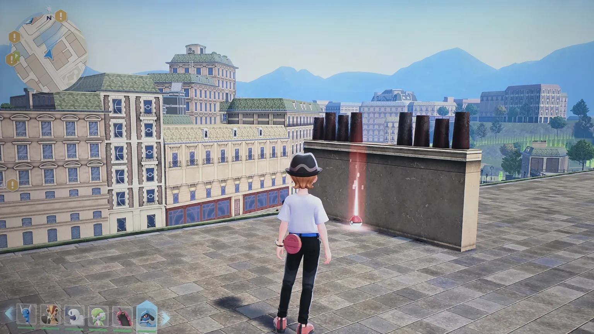
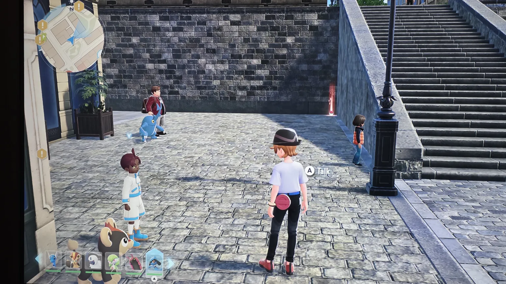

# Lumiose Atlas collectible locations

Field guide to item pickups and Colorful Screws photographed in Pokémon Legends: Z-A. Each find has its own entry with the in-game location, a landmark to look for, and the photographs used to identify it.

## Hyper Potion — Vert Sector 7 rooftop

On the in-game map, find the building beside **Vert Street** marked by the player arrow and red circle in the [sector view](../../assets/atlas/collectibles/vert-7-hyper-potion-rooftop/map-sector.webp). It is on the same side of Vert Street as the small garden with the looping path. Use the [close-up](../../assets/atlas/collectibles/vert-7-hyper-potion-rooftop/map-close.webp) to match the exact building outline.

From the roof shown in the gameplay photo, look across to the short, raised section of green metal roof beside the terrace with café tables and a cluster of pink crystals. The pickup ball is on that raised section, under the pink beam.

Trev identified the pickup as a Hyper Potion and surveyed the spot after unlocking Hover Glide. The gameplay photo shows the ball before collection. The route from street level, whether Hover Glide is required, and the exact coordinates on the Atlas basemap still need verification.

| Photo | What to look for | Source filename |
| --- | --- | --- |
| [Rooftop pickup](../../assets/atlas/collectibles/vert-7-hyper-potion-rooftop/pickup-rooftop.webp) | Pickup beam, green metal roof, café terrace and pink crystals | `1000029144.webp` |
| [Close map view](../../assets/atlas/collectibles/vert-7-hyper-potion-rooftop/map-close.webp) | The marked building outline and Vert Street label | `1000029145.webp` |
| [Sector map view](../../assets/atlas/collectibles/vert-7-hyper-potion-rooftop/map-sector.webp) | The same roof beside the garden and the Vert Sector 7 label | `1000029146.webp` |
| [Neighbourhood map view](../../assets/atlas/collectibles/vert-7-hyper-potion-rooftop/map-neighbourhood.webp) | The building in relation to the nearby Pokémon Center and surrounding blocks | `1000029143.webp` |

## Dive Ball — Vert Sector 7 rooftop

On the in-game map, find the canal-facing end of the building beside **Vert Street** in the [block view](../../assets/atlas/collectibles/vert-7-dive-ball-rooftop/map-block.webp). The [close-up](../../assets/atlas/collectibles/vert-7-dive-ball-rooftop/map-close.webp) shows where the player was standing. It is the same building outline as the Hyper Potion above, with the player marker closer to the canal.

On the flat, gray-tiled roof, look for the long chimney wall topped with two groups of dark pipes. The pink pickup beam is at the base of that wall. The [collection photo](../../assets/atlas/collectibles/vert-7-dive-ball-rooftop/pickup-confirmation.webp) shows the game awarding **Dive Ball ×1** next to the same chimney.

The route up from street level and the exact coordinates on the Atlas basemap still need verification.

| Photo | What to look for | Source filename |
| --- | --- | --- |
| [Rooftop pickup](../../assets/atlas/collectibles/vert-7-dive-ball-rooftop/pickup-rooftop.webp) | Pink beam at the base of the chimney wall | `1000029152.webp` |
| [Neighbourhood map view](../../assets/atlas/collectibles/vert-7-dive-ball-rooftop/map-neighbourhood.webp) | The surrounding canal, garden and street blocks | `1000029153.webp` |
| [Block map view](../../assets/atlas/collectibles/vert-7-dive-ball-rooftop/map-block.webp) | The building beside Vert Street and the canal | `1000029154.webp` |
| [Close map view](../../assets/atlas/collectibles/vert-7-dive-ball-rooftop/map-close.webp) | The player marker at the canal-facing end of the building | `1000029155.webp` |
| [Collection confirmation](../../assets/atlas/collectibles/vert-7-dive-ball-rooftop/pickup-confirmation.webp) | The on-screen award of one Dive Ball at the chimney | `1000029156.webp` |

## Potion — Vert Sector 7 staircase

Find the wide stone staircase beside the small garden with the looping path, between **Vert Street** and **Racine Construction**. The [neighbourhood map](../../assets/atlas/collectibles/vert-7-potion-staircase/map-neighbourhood.webp) shows the spot in relation to the Pokémon Center near Station Front. Use the [close map view](../../assets/atlas/collectibles/vert-7-potion-staircase/map-close.webp) to pick out the correct staircase.

Face up the steps and stay on the cobbled landing to their left. Walk past the black lamppost to the back corner, where the side wall of the stairs meets the dark stone retaining wall. The pickup beam is at ground level in that corner. The [collection photo](../../assets/atlas/collectibles/vert-7-potion-staircase/pickup-confirmation.webp) confirms **Potion ×1**.

The exact point on the Atlas basemap still needs verification for a live pin.

| Photo | What to look for | Source filename |
| --- | --- | --- |
| [Pickup beside the stairs](../../assets/atlas/collectibles/vert-7-potion-staircase/pickup-at-stairs.webp) | The wide steps, black lamppost and pickup beam in the back corner | `1000029162.webp` |
| [Wide map view](../../assets/atlas/collectibles/vert-7-potion-staircase/map-wide.webp) | The player's position in the wider Vert district | `1000029163.webp` |
| [Neighbourhood map view](../../assets/atlas/collectibles/vert-7-potion-staircase/map-neighbourhood.webp) | Vert Street, Racine Construction and the nearby Pokémon Center | `1000029164.webp` |
| [Close map view](../../assets/atlas/collectibles/vert-7-potion-staircase/map-close.webp) | The steps beside the small garden in Vert Sector 7 | `1000029165.webp` |
| [Collection confirmation](../../assets/atlas/collectibles/vert-7-potion-staircase/pickup-confirmation.webp) | The on-screen award of one Potion at the foot of the wall | `1000029166.webp` |

## Rare Candy — Vert Sector 7 by Coulant Waterway

On the in-game map, find **Café Cyclone** and the nearby crossing over **Coulant Waterway**. The [close map view](../../assets/atlas/collectibles/vert-7-rare-candy-waterway/map-close.webp) shows the player beside the building at the Vert Sector 7 end of the crossing.

From the paved walkway beside the pale shutters, step into the flower bed between the building and the stone railing. Look just past the tree, among the blue and white flowers toward the green steel bridge supports. The [collection photo](../../assets/atlas/collectibles/vert-7-rare-candy-waterway/pickup-confirmation.webp) confirms **Rare Candy ×1** in that flower bed.

The exact point on the Atlas basemap still needs verification for a live pin.

| Photo | What to look for | Source filename |
| --- | --- | --- |
| [Pickup in the flower bed](../../assets/atlas/collectibles/vert-7-rare-candy-waterway/pickup-in-flower-bed.webp) | The tree, shuttered windows, stone railing and pink pickup beam | `1000029172.webp` |
| [Wide map view](../../assets/atlas/collectibles/vert-7-rare-candy-waterway/map-wide.webp) | The player's position in the wider Vert district | `1000029173.webp` |
| [Neighbourhood map view](../../assets/atlas/collectibles/vert-7-rare-candy-waterway/map-neighbourhood.webp) | Café Cyclone, Coulant Waterway, Vert Street and Racine Construction | `1000029174.webp` |
| [Close map view](../../assets/atlas/collectibles/vert-7-rare-candy-waterway/map-close.webp) | The building and flower bed by the crossing | `1000029175.webp` |
| [Collection confirmation](../../assets/atlas/collectibles/vert-7-rare-candy-waterway/pickup-confirmation.webp) | The on-screen award of one Rare Candy beside the steel bridge supports | `1000029176.webp` |

## Great Ball — Vert Sector 7 under the Coulant Waterway bridge

Find the **Coulant Waterway** crossing near **Café Cyclone**. The [close map view](../../assets/atlas/collectibles/vert-7-great-ball-under-bridge/map-close.webp) shows the player at the Vert Sector 7 end of the crossing, close to the Rare Candy flower bed above.

Go to the lower cobbled plaza beneath the green steel bridge. Facing the wide stone staircase from the plaza, look to its right, under the bridge beams. The pickup is in the inside corner where the two dark stone walls meet. The [collection photo](../../assets/atlas/collectibles/vert-7-great-ball-under-bridge/pickup-confirmation.webp) confirms **Great Ball ×1** in that corner.

The exact point on the Atlas basemap still needs verification for a live pin.

| Photo | What to look for | Source filename |
| --- | --- | --- |
| [Pickup beneath the bridge](../../assets/atlas/collectibles/vert-7-great-ball-under-bridge/pickup-under-bridge.webp) | Green steel beams, wide staircase and pickup beam in the stone corner | `1000029182.webp` |
| [Wide map view](../../assets/atlas/collectibles/vert-7-great-ball-under-bridge/map-wide.webp) | The crossing in the wider Vert district | `1000029183.webp` |
| [Neighbourhood map view](../../assets/atlas/collectibles/vert-7-great-ball-under-bridge/map-neighbourhood.webp) | Café Cyclone, Coulant Waterway, Vert Street and Racine Construction | `1000029184.webp` |
| [Close map view](../../assets/atlas/collectibles/vert-7-great-ball-under-bridge/map-close.webp) | The player marker at the Vert Sector 7 end of the crossing | `1000029185.webp` |
| [Collection confirmation](../../assets/atlas/collectibles/vert-7-great-ball-under-bridge/pickup-confirmation.webp) | The on-screen award of one Great Ball where the stone walls meet | `1000029186.webp` |

## Potion — Vert Sector 7 raised walkway by Coulant Waterway

Find **Café Cyclone** and the crossing over **Coulant Waterway**. At the Vert Sector 7 end of the crossing, locate the building overlooking the construction scaffolding. The close in-game map photograph places the player on the walkway beside the building, east of Café Cyclone.

On the raised cobbled walkway alongside the pale building, walk towards the end of the stone railing overlooking the lower plaza. Look for the red pickup beam beside the low stone parapet, facing the black scaffolding towers with yellow ladders and an arrow-marked ramp. The final gameplay photograph confirms **Potion ×1** at this spot. This is a separate pickup from the ground-level staircase Potion above.

The route onto the raised walkway, any movement prerequisites, and the exact point on the Atlas basemap still need verification. Do not publish a live pin from the player marker alone.

**Evidence status:** All five supplied photographs were visually reviewed and decoded at 1536 × 865. Although the supplied filenames end in `.jpg`, the actual files are WebP. Their original bytes have been preserved for transfer. GitHub binary upload is pending; the following filenames identify the evidence and planned repository destination, not existing image links.

Destination: `assets/atlas/collectibles/vert-7-potion-raised-walkway/`.

| Photo | What to look for | Source filename | Destination filename |
| --- | --- | --- | --- |
| Pickup on raised walkway | Red pickup beam, low stone parapet, scaffolding and yellow ladders | `1000029192.jpg` | `pickup-on-walkway.webp` |
| Wide map view | Position within the wider Vert district | `1000029193.jpg` | `map-wide.webp` |
| Neighbourhood map view | Café Cyclone, Coulant Waterway, Vert Sector 6 and Vert Sector 7 | `1000029194.jpg` | `map-neighbourhood.webp` |
| Close map view | Player marker beside the building at the crossing | `1000029195.jpg` | `map-close.webp` |
| Collection confirmation | On-screen award of one Potion beside the scaffolding | `1000029196.jpg` | `pickup-confirmation.webp` |

## Potion — Vert Sector 7 scaffold planter by Coulant Waterway

Use the in-game map to locate **Café Cyclone** and the **Coulant Waterway** crossing. The three map photographs show the player close to the crossing, east of the café, near the lower construction plaza.

On the lower paved plaza beneath the green steel bridge, locate the tall black scaffolding tower next to a stone balustrade. Beside the tower is a narrow planted border with grass and a large round shrub. The red pickup beam is at ground level in the planting, immediately beside the shrub and stone corner post. The wide staircase opposite and overhead bridge provide additional visual landmarks. The final gameplay photograph confirms **Potion ×1** beside that shrub.

This is a separate pickup from the staircase Potion and raised-walkway Potion above. Another visible pickup beam on the nearby scaffold platform is not identified by this evidence and must not be catalogued as this Potion. The photographs were taken at night; a nighttime-only requirement has not been established. The precise Atlas basemap coordinate and access route from street level remain to be verified before publishing a live marker.

**Evidence status:** All five photographs were visually reviewed and decoded as genuine WebP images (1536 × 865, except the close map at 1536 × 831). Original bytes were preserved without re-encoding. GitHub binary upload is pending; the following are planned destinations, not existing image links.

Destination: `assets/atlas/collectibles/vert-7-potion-scaffold-planter/`.

| Photo | What to look for | Source filename | Destination filename |
| --- | --- | --- | --- |
| Pickup in planted border | Red beam, round shrub, tall scaffolding tower and stone post | `1000029204.jpg` | `pickup-in-planted-border.webp` |
| Wide map view | Position in the wider Vert district | `1000029205.jpg` | `map-wide.webp` |
| Neighbourhood map view | Café Cyclone, Coulant Waterway, Vert Sector 6 and Vert Sector 7 | `1000029206.jpg` | `map-neighbourhood.webp` |
| Close map view | Player marker beside the waterway crossing | `1000029207.jpg` | `map-close.webp` |
| Collection confirmation | On-screen award of one Potion beside the round shrub | `1000029208.jpg` | `pickup-confirmation.webp` |

## Carbos — Vert Sector 7 scaffold platform by Coulant Waterway

Find **Café Cyclone** and **Coulant Waterway** on the in-game map. The three map views place the player just east of the café near the crossing and construction plaza.

On the lower paved plaza, identify the black scaffolding assembly with yellow ladders and an arrow-marked ramp. The red pickup beam is on the raised side platform extending from the taller scaffold tower beside the tall yellow ladder and traffic cone, in front of the stone retaining wall. The final gameplay photograph shows the player standing on a platform and the award **Carbos ×1**. This is consistent with the previously unidentified elevated pickup beam visible in the scaffold-planter Potion evidence; it is a separate pickup from that Potion.

The photographs establish the pickup position and item identity. The exact climb sequence, any movement prerequisites, and the precise Atlas basemap coordinate remain unverified. Photographed at night; no nighttime-only requirement is established.

**Evidence status:** Five genuine WebP photographs decoded and visually reviewed, with original bytes preserved (1536 × 865 except the wide map at 1536 × 842). Binary upload to GitHub is pending; the following are planned destinations, not live image links.

Destination: `assets/atlas/collectibles/vert-7-carbos-scaffold-platform/`.

| Photo | What to look for | Source filename | Destination filename |
| --- | --- | --- | --- |
| Pickup on scaffold | Red beam, raised side platform, traffic cone and tall yellow ladder | `1000029216.jpg` | `pickup-on-scaffold.webp` |
| Wide map view | Position in the wider Vert district | `1000029217.jpg` | `map-wide.webp` |
| Neighbourhood map view | Café Cyclone, Coulant Waterway and Vert Sectors 6–7 | `1000029218.jpg` | `map-neighbourhood.webp` |
| Close map view | Player marker beside the waterway | `1000029219.jpg` | `map-close.webp` |
| Collection confirmation | On-screen award of one Carbos from the scaffold platform | `1000029220.jpg` | `pickup-confirmation.webp` |

## Colorful Screw — Vert Sector 7 covered scaffold by Coulant Waterway

Field catalogue find 009; Colorful Screw 001 in this photographic collection (not an official in-game numbering scheme).

Find **Café Cyclone** and the nearby **Coulant Waterway** bridge on the in-game map. The three map photographs place the player near the crossing east of the café.

Climb to the upper scaffolding platform with a yellow ladder opening. Face the covered scaffold tower beside the green steel bridge, identifiable by its patterned canopy and the purple collectible beam. Cross the narrow metal beam connecting the platforms. The screw sits on the elevated platform underneath the canopy, overlooking the waterway. The final gameplay photograph confirms **Colorful Screw ×1** on that platform. It is a separate collectible from the Carbos on the lower scaffold platform and the Potion in the planted border.

The photographed beam crossing and pickup position are established; the full climb from ground level, any movement prerequisites, and the exact Atlas basemap coordinate remain unverified. Photographed at night; no nighttime-only requirement is established. Do not publish a live marker until the basemap coordinate is checked.

**Evidence status:** Five genuine WebP photographs visually reviewed and decoded at 1536 × 865. Original bytes preserved and checked byte-for-byte in the local upload archive. Binary upload to GitHub remains pending; the following are planned destinations, not live image links.

Destination: `assets/atlas/collectibles/vert-7-colorful-screw-covered-scaffold/`.

| Photo | What to look for | Source filename | Destination filename |
| --- | --- | --- | --- |
| Pickup on covered platform | Purple beam, narrow metal crossing, scaffold canopy and bridge | `1000029226.jpg` | `pickup-on-covered-platform.webp` |
| Wide map view | Position within the wider Vert district | `1000029227.jpg` | `map-wide.webp` |
| Neighbourhood map view | Café Cyclone, Coulant Waterway and surrounding Vert sectors | `1000029228.jpg` | `map-neighbourhood.webp` |
| Close map view | Player marker near the crossing; distinguish player position from the pickup across the beam | `1000029229.jpg` | `map-close.webp` |
| Collection confirmation | On-screen award of one Colorful Screw beneath the canopy | `1000029230.jpg` | `pickup-confirmation.webp` |

## Pearl — Coulant Waterway east-bank tree planter near Vert Sector 6

Field catalogue find 010.

Locate **Café Cyclone**, then follow **Coulant Waterway** north-east towards the bridge beside **Vert Sector 6**. The close in-game map shows the player immediately east of the canal, south of that bridge; the wider map gives context relative to Vert Plaza and Wild Zone 11.

On the lower cobbled promenade, face the broad stairs leading towards the green-lit area. The planted strip along the canal's stone balustrade contains round shrubs, flowers and trees. Look for the red pickup beam at the foot of the nearer tree, among the flowers. The final gameplay photograph confirms **Pearl ×1** beside that tree. The other red beams farther towards the steps and across the canal are distinct pickups whose identities are not established by this batch.

The location is on the canal-side boundary near Vert Sector 6, rather than the earlier scaffold cluster. The exact sector boundary designation and Atlas basemap coordinate remain unverified. Photographed at night; no nighttime-only requirement is established.

**Evidence status:** All five original WebP photographs decoded at 1536 × 865 and visually reviewed. Their exact bytes are preserved and verified in the local upload archive. GitHub binary transfer remains pending; these are planned destinations, not live links.

Destination: `assets/atlas/collectibles/coulant-waterway-pearl-tree/`.

| Photo | What to look for | Source filename | Destination filename |
| --- | --- | --- | --- |
| Pickup by tree | Red beam at the foot of the nearer tree beside the canal balustrade | `1000029236.jpg` | `pickup-by-tree.webp` |
| Wide map view | Wider Vert district and Wild Zones 2 and 11 | `1000029237.jpg` | `map-wide.webp` |
| Neighbourhood map view | Café Cyclone, Coulant Waterway and Vert Sector 6 | `1000029238.jpg` | `map-neighbourhood.webp` |
| Close map view | Player on the east bank just south of the bridge | `1000029239.jpg` | `map-close.webp` |
| Collection confirmation | On-screen award of one Pearl beside the tree and white flowers | `1000029240.jpg` | `pickup-confirmation.webp` |

## Revive — Coulant Waterway east-bank staircase planter near Vert Sector 6

Field catalogue find 011.

Follow the lower east-bank promenade of **Coulant Waterway** towards **Vert Sector 6** and the wide staircase. The close map shows the player on the east bank of the canal, north of the nearby bridge. This is a different location from the Pearl farther south.

Facing the staircase, look in the planted strip on the left beside the canal balustrade. The approach photo shows a red pickup beam farther along the strip near the staircase, beyond the foreground pink crystals and shrubs. The final photo confirms **Revive ×1** beside the round shrub, flowers and stepped stone planters at the foot of the staircase. The pink crystals in the approach photograph are not the Revive.

The exact point on the Atlas basemap and sector boundary designation remain unverified. No live marker added.

**Evidence status:** All five supplied photographs decoded as genuine WebP images and visually reviewed. Original bytes verified in the local upload archive. GitHub binary transfer remains pending; these are planned destinations, not live links.

Destination: `assets/atlas/collectibles/coulant-waterway-revive-east-bank-stairs/`.

| Photo | What to look for | Source filename | Destination filename |
| --- | --- | --- | --- |
| Staircase planter approach | Red pickup beam in the planted strip near the stairs, beyond the foreground crystals | `1000029246.jpg` | `pickup-by-stair-planter.webp` |
| Wide map view | Wider Vert district and Wild Zones 2 and 11 | `1000029247.jpg` | `map-wide.webp` |
| Neighbourhood map view | Café Cyclone, Coulant Waterway and Vert Sector 6 | `1000029248.jpg` | `map-neighbourhood.webp` |
| Close map view | Player on the east side of the canal north of the bridge | `1000029249.jpg` | `map-close.webp` |
| Collection confirmation | On-screen award of one Revive beside the shrub and stepped planters | `1000029250.jpg` | `pickup-confirmation.webp` |

## Potion — Coulant Waterway west-bank stone recess near Vert Sector 3

Field catalogue find 012; a fourth distinct Potion pickup in this photographic collection.

From **Café Cyclone**, follow the lower western canal-side path towards **Vert Sector 3**, keeping the water to your right. The close map places the player west of the waterway and north of the crossing, opposite Vert Sector 6.

Look for the stone building wall with an arched window and a square planter, immediately beside a staircase. The red pickup beam is at ground level in the recessed inside corner of the wall to the left of the staircase. The last gameplay photo confirms **Potion ×1** in that stone corner. This is distinct from the previously documented Vert Sector 7 staircase, raised walkway and scaffold planter Potions.

The map shows the player's nearby position, not a calibrated collectible coordinate. The exact Atlas basemap point and sector boundary designation remain unverified. No live marker added.

**Evidence status:** Use only the five replacement photographs below, as requested by the contributor. The superseded HEIC batch is excluded. All five replacements decoded as genuine WebP images and their original bytes verified in the local upload archive. GitHub binary transfer remains pending; these are planned destinations, not live links.

Destination: `assets/atlas/collectibles/coulant-waterway-potion-west-bank-recess/`.

| Photo | What to look for | Source filename | Destination filename |
| --- | --- | --- | --- |
| Wall recess approach | Red pickup beam in the inside stone corner immediately left of the stairs | `1000029256.jpg` | `pickup-in-wall-recess.webp` |
| Wide map view | Wider Vert district | `1000029257.jpg` | `map-wide.webp` |
| Neighbourhood map view | Vert Sectors 3 and 6, Café Cyclone and Coulant Waterway | `1000029258.jpg` | `map-neighbourhood.webp` |
| Close map view | Player on the west side of the canal north of the crossing | `1000029259.jpg` | `map-close.webp` |
| Collection confirmation | On-screen award of one Potion in the stone recess | `1000029260.jpg` | `pickup-confirmation.webp` |

## Super Potion — Coulant Waterway west-bank tree planter near Vert Sector 3

Field catalogue find 013.

Locate **Coulant Waterway** between **Vert Sector 3** and **Vert Sector 6**. The close map photograph places the player near the northern end of the canal section, on its western edge beside the stairs and south of Wild Zone 11.

On the canal-side staircase landing, face along the waterway towards Café Cyclone. Look in the planted border beside the stone balustrade for the red pickup beam between the near tree and the round shrub, among the red flowers. The final gameplay photograph confirms **Super Potion ×1** beside the same tree. This is distinct from the Potion in the stone wall recess on the western bank and from the Pearl and Revive on the eastern bank.

The map indicates the player's nearby position, not a calibrated collectible coordinate. The precise Atlas basemap point and sector boundary designation remain unverified. No live marker added.

**Evidence status:** Five genuine WebP photographs visually reviewed and decoded, with dimensions ranging from 1536 × 776 to 1536 × 865. Their original bytes were verified in the local upload archive. Binary transfer to GitHub is pending; these are planned destinations, not live links.

Destination: `assets/atlas/collectibles/coulant-waterway-super-potion-west-bank-tree/`.

| Photo | What to look for | Source filename | Destination filename |
| --- | --- | --- | --- |
| Pickup by tree | Red beam between the tree and rounded shrub on the canal-side landing | `1000029266.jpg` | `pickup-by-tree.webp` |
| Wide map view | Wider Vert district and Wild Zones 2 and 11 | `1000029267.jpg` | `map-wide.webp` |
| Neighbourhood map view | Café Cyclone, Vert Sectors 3 and 6, Coulant Waterway | `1000029268.jpg` | `map-neighbourhood.webp` |
| Close map view | Player near the northern end of the canal on its western edge | `1000029269.jpg` | `map-close.webp` |
| Collection confirmation | On-screen award of one Super Potion by the tree | `1000029270.jpg` | `pickup-confirmation.webp` |

## Antidote — Vert Sector 3 upper terrace overlooking Wild Zone 11

Field catalogue find 014.

Locate **Vert Sector 3** on the map, immediately west of **Wild Zone 11 (Jaune Sector 10)** and south of **Saison Canal**. The close map places the player near the northeastern corner of Vert Sector 3, just outside the western green boundary of the wild zone.

Follow the upper cobbled terrace beside the wild zone. Look for wooden benches, a black lamppost by the stair opening and a square planter containing a small tree. The red pickup beam is in the far corner beside the planter where the stone parapet turns, overlooking the water and grassy terraces of Wild Zone 11. The final gameplay photograph confirms **Antidote ×1** at this corner, outside the wild zone. Do not confuse it with the other pickup beam visible below in the wild zone.

The precise Atlas basemap coordinate and any access prerequisites remain unverified. No live marker added.

**Evidence status:** Five genuine WebP photographs decoded and visually reviewed, with dimensions ranging from 1536 × 793 to 1536 × 865. Original bytes were verified against all five files in the local upload archive. GitHub binary transfer remains pending; these are planned destinations, not live links.

Destination: `assets/atlas/collectibles/vert-3-antidote-wild-zone-11-terrace/`.

| Photo | What to look for | Source filename | Destination filename |
| --- | --- | --- | --- |
| Pickup by terrace planter | Red beam beside the benches, square planter and parapet | `1000029276.jpg` | `pickup-by-terrace-planter.webp` |
| Wide map view | Vert district and Wild Zones 2 and 11 | `1000029277.jpg` | `map-wide.webp` |
| Neighbourhood map view | Vert Sector 3, Saison Canal and Jaune Sector 10 | `1000029278.jpg` | `map-neighbourhood.webp` |
| Close map view | Player near the western boundary of Wild Zone 11 | `1000029279.jpg` | `map-close.webp` |
| Collection confirmation | On-screen award of one Antidote beside the terrace planter | `1000029280.jpg` | `pickup-confirmation.webp` |

## Super Potion — Vert Sector 3 Wild Zone 11 balustrade

Field catalogue find 015; the second distinct Super Potion in this photographic collection.

Locate **Vert Sector 3** immediately west of **Wild Zone 11 (Jaune Sector 10)**. The three in-game map photographs show the player along the western green boundary of the wild zone, slightly south of the earlier Antidote terrace location.

Follow the paved promenade alongside the wild-zone boundary. Look for the stone balustrade between two square wooden planters containing small trees. The red pickup beam stands directly on the pavement beside the railing, opposite the lower grassy area near the green Wild Zone 11 entrance pillars. The final gameplay photograph confirms **Super Potion ×1** beside this balustrade. The red pickup beam visible below inside the wild zone is a different, unidentified item. This Super Potion is distinct from the west-bank tree-planter Super Potion in find 013 and from the Antidote in find 014.

The photographs establish the item identity and pickup position relative to the railing. The precise Atlas basemap coordinate and any access prerequisites remain unverified. No live marker added.

**Evidence status:** Five genuine WebP photographs decoded and visually reviewed (1536 pixels wide, heights 806–865 pixels). Original bytes verified against all five files in the cumulative local upload archive. GitHub binary transfer remains pending; these are planned destinations, not live image links.

Destination: `assets/atlas/collectibles/vert-3-super-potion-wild-zone-11-balustrade/`.

| Photo | What to look for | Source filename | Destination filename |
| --- | --- | --- | --- |
| Pickup beside balustrade | Red beam on the pavement between two square planters, outside the railing | `1000029287.jpg` | `pickup-by-balustrade.webp` |
| Wide map view | Wider Vert district and Wild Zones 2 and 11 | `1000029288.jpg` | `map-wide.webp` |
| Neighbourhood map view | Vert Sector 3, Saison Canal and Jaune Sector 10 | `1000029289.jpg` | `map-neighbourhood.webp` |
| Close map view | Player beside the western Wild Zone 11 boundary | `1000029290.jpg` | `map-close.webp` |
| Collection confirmation | On-screen award of one Super Potion at the railing | `1000029291.jpg` | `pickup-confirmation.webp` |

## Dusk Ball — Vert Sector 3 lower Saison Canal promenade by lamppost

Field catalogue find 016.

Locate **Saison Canal** immediately north of **Vert Sector 3** and west of **Wild Zone 11 (Jaune Sector 10)**. The three map photographs place the player near the southeastern edge of Saison Canal, on the southern bank just west of the wild-zone boundary.

Descend to the lower cobbled canal-side promenade near the western boundary of Wild Zone 11. Face along the canal towards the stone arched bridge and Prism Tower, keeping the water and black railing on the right and the stone retaining wall with ivy on the left. The approach photograph shows the red pickup beam at the foot of the first ornate black lamppost. The final gameplay photograph confirms **Dusk Ball ×1** beside that lamppost. The nearby pedestrian is an incidental visual reference, not a required encounter.

The photographs establish item identity, level and pickup position relative to the lamppost. The map marker records the player's nearby position, not a calibrated collectible coordinate. The precise Atlas basemap point remains unverified. No live marker added.

**Evidence status:** All five original photographs decoded as genuine WebP (1536 pixels wide, heights 834–865 pixels). Their bytes were compared against the new cumulative archive, and the existing 50 archived photographs were verified unchanged. GitHub binary transfer remains pending; these are planned destinations, not live image links.

Destination: `assets/atlas/collectibles/vert-3-dusk-ball-saison-canal-lamppost/`.

| Photo | What to look for | Source filename | Destination filename |
| --- | --- | --- | --- |
| Pickup by lamppost | Red beam at foot of black lamppost on lower canal promenade | `1000029298.jpg` | `pickup-by-lamppost.webp` |
| Wide map view | Wider Vert district and Wild Zones 2 and 11 | `1000029299.jpg` | `map-wide.webp` |
| Neighbourhood map view | Saison Canal, Vert Sector 3 and Jaune Sector 10 | `1000029300.jpg` | `map-neighbourhood.webp` |
| Close map view | Player on southern canal bank just west of Wild Zone 11 | `1000029301.jpg` | `map-close.webp` |
| Collection confirmation | On-screen award of one Dusk Ball beside the lamppost | `1000029302.jpg` | `pickup-confirmation.webp` |

## Revive — Vert Sector 3 raised Saison Canal walkway

Field catalogue find 017; the second distinct Revive in this photographic collection.

Locate **Saison Canal** immediately north of **Vert Sector 3**, west of **Wild Zone 11 (Jaune Sector 10)**. The three in-game map photographs place the player on the southern canal bank close to the bridge and staircase, farther west than the earlier Dusk Ball location.

Descend the broad stone staircase to the cobbled landing. Locate the slightly raised building-side walkway parallel to the lower waterfront promenade. Facing towards Wild Zone 11 with the canal on the left, look for the red pickup beam on the raised walkway in the corner between the building with blue windows and the projecting stone retaining wall. The final gameplay photograph confirms **Revive ×1** in that corner. This is distinct from the Revive beside the east-bank staircase planter on Coulant Waterway (find 011), and from the Dusk Ball on the lower Saison Canal promenade (find 016). Other visible pickup beams and pink crystals are not identified by this photo set.

The photographs establish item identity and elevation. The map views show the player's approach position, not a calibrated collectible coordinate. The exact Atlas basemap point and any special access requirements remain unverified. No live marker added.

**Evidence status:** All five original photographs decoded as genuine WebP (1536 pixels wide, heights 821–865 pixels). Original bytes verified against all five new files in the cumulative 60-photo upload archive, with all 55 earlier archived files confirmed unchanged. GitHub binary transfer remains pending; the following are planned destinations, not live image links.

Destination: `assets/atlas/collectibles/vert-3-revive-saison-canal-raised-walkway/`.

| Photo | What to look for | Source filename | Destination filename |
| --- | --- | --- | --- |
| Pickup in wall corner | Red beam on raised building-side walkway, beside projecting stone wall | `1000029308.jpg` | `pickup-in-wall-corner.webp` |
| Wide map view | Wider Vert district and Wild Zones 2 and 11 | `1000029309.jpg` | `map-wide.webp` |
| Neighbourhood map view | Saison Canal, Vert Sector 3 and Jaune Sector 10 | `1000029310.jpg` | `map-neighbourhood.webp` |
| Close map view | Player on southern bank near bridge and staircase | `1000029311.jpg` | `map-close.webp` |
| Collection confirmation | On-screen award of one Revive in the stone wall corner | `1000029312.jpg` | `pickup-confirmation.webp` |

## Burn Heal — Saison Canal bridge between Vert Sectors 1 and 3

Field catalogue find 018.

Locate the bridge over **Saison Canal** between **Vert Sector 1** and **Vert Sector 3**, west of Wild Zone 11. The three map photographs place the player near the southern end of this crossing, above the lower canal-side paths.

On the upper bridge, look for the red-brick paving, circular decorative pavement motifs and stone balustrades. The approach photograph shows a red pickup beam beside the balustrade towards the southern end of the crossing. The final gameplay photograph confirms **Burn Heal ×1** at that railing. The nearby pedestrians are incidental and not required for collection. This is a distinct upper-level pickup, not the Dusk Ball or Revive recorded on the lower and raised building-side promenades in finds 016 and 017.

The photographs establish the item identity and bridge-level position. The map views show the player's nearby position rather than a calibrated collectible coordinate. The precise Atlas basemap point remains unverified. No live marker added.

**Evidence status:** Five original photographs decoded as genuine WebP (1536 pixels wide, heights 826–865 pixels). All five files were verified byte-for-byte in the cumulative 65-photo archive, and all 60 previous archived files were verified unchanged. GitHub binary transfer remains pending; these are planned destinations, not live image links.

Destination: `assets/atlas/collectibles/saison-canal-burn-heal-bridge/`.

| Photo | What to look for | Source filename | Destination filename |
| --- | --- | --- | --- |
| Pickup beside bridge balustrade | Red beam beside stone railing on brick-paved bridge | `1000029318.jpg` | `pickup-by-bridge-balustrade.webp` |
| Wide map view | Bridge location relative to Vert Plaza and Wild Zone 11 | `1000029319.jpg` | `map-wide.webp` |
| Neighbourhood map view | Saison Canal and Vert Sectors 1 and 3 | `1000029320.jpg` | `map-neighbourhood.webp` |
| Close map view | Player near the southern end of the bridge | `1000029321.jpg` | `map-close.webp` |
| Collection confirmation | On-screen award of one Burn Heal at the stone balustrade | `1000029322.jpg` | `pickup-confirmation.webp` |

## Poké Ball — Vert Plaza northeast landscaped strip beside scaffolding

Field catalogue find 019.

Locate **Vert Plaza (Wild Zone 2)** and the route running between **Vert Sectors 1 and 3** towards the bridge over **Saison Canal**. The three in-game map photographs place the player near the southern end of the elongated landscaped strip, immediately northeast of Vert Plaza and outside the wild-zone boundary.

From Vert Plaza, head towards Saison Canal along this route. Look for the building covered in black construction scaffolding, with cyan-edged platforms and arrow-marked ramps. Beside the scaffolding is a grassy landscaped strip with trees, shrubs and flowers. The approach photograph shows a red pickup beam at the base of the nearer tree, beside flowering plants. The final gameplay photograph confirms **Poké Ball ×1** beside that tree. Nearby pink crystals and other visible sparkles are separate features, not this pickup.

The item is at ground level; the photographs do not establish any need to climb the scaffolding. The map views record the player's nearby position, not a calibrated collectible coordinate. The exact Atlas basemap point and formal sector designation remain unverified. No live marker added.

**Evidence status:** All five original photographs decoded as genuine WebP at 1536 × 865. Original bytes verified against all five new files in the cumulative 70-photo upload archive, with all 65 previous archived photographs confirmed unchanged. GitHub binary transfer remains pending; the following are planned destinations, not live image links.

Destination: `assets/atlas/collectibles/vert-plaza-poke-ball-scaffold-tree/`.

| Photo | What to look for | Source filename | Destination filename |
| --- | --- | --- | --- |
| Pickup by tree | Red beam at the tree base beside flowers and scaffolding | `1000029328.jpg` | `pickup-by-tree.webp` |
| Wide map view | Location relative to Wild Zones 2 and 11 | `1000029329.jpg` | `map-wide.webp` |
| Neighbourhood map view | Vert Plaza, Vert Sectors 1 and 3 and Saison Canal | `1000029330.jpg` | `map-neighbourhood.webp` |
| Close map view | Player at the southern end of the landscaped strip northeast of Vert Plaza | `1000029331.jpg` | `map-close.webp` |
| Collection confirmation | On-screen award of one Poké Ball beside the tree | `1000029332.jpg` | `pickup-confirmation.webp` |

## Dazzling Gleam — Magenta Plaza central monument (Wild Zone 7)

Field catalogue find 020; first Technical Machine (TM) in this photographic collection. Keep the TM category separate from ordinary items and Colorful Screws; the catalogue numbering is not official game numbering.

Locate **Magenta Plaza (Wild Zone 7)** on the in-game map. It is the circular wild zone west of Prism Tower, between the two sections of Saison Canal, with a Pokémon Center nearby to the southeast. The three map photographs show the selected Wild Zone 7 travel marker at the center of Magenta Plaza.

Enter the wild zone and head towards the central stone monument with engraved geometric symbols on its pedestal. The approach photograph shows a golden pickup beam at ground level directly in front of the engraved panel, between two clusters of thorny roots. Collect the TM from the base of the monument. The final gameplay photograph shows a new purple TM disc and the visible beginning of the name “Dazzling Gl…”, consistent with the contributor's identification of **Dazzling Gleam**. The remainder of the pickup text is cropped at the right edge. The red beam among the roots is a distinct unidentified pickup and must not be assigned to this TM.

The monument provides a strong in-world location reference, but the map cursor is snapped to the wild-zone travel marker and is not a calibrated item coordinate. Exact Atlas basemap placement and any access prerequisites beyond entering Wild Zone 7 remain to be verified. No live marker added. Reserve a distinct TM filter and checklist category for later integration; this entry does not implement or alter the live map or player progress.

**Evidence status:** Five original photographs decoded as genuine WebP at 1536 × 865 pixels and visually reviewed. All five new files were verified byte-for-byte in the cumulative 75-photo archive, and all 70 earlier archived files were confirmed unchanged. GitHub binary transfer remains pending; these are planned destinations, not live image links.

Destination: `assets/atlas/collectibles/magenta-plaza-dazzling-gleam-monument/`.

| Photo | What to look for | Source filename | Destination filename |
| --- | --- | --- | --- |
| Pickup at monument | Golden beam in front of the engraved stone pedestal | `1000029350.jpg` | `pickup-at-monument.webp` |
| Wide map view | Magenta Plaza relative to Wild Zones 5 and 9 and Prism Tower | `1000029351.jpg` | `map-wide.webp` |
| Neighbourhood map view | Magenta Plaza, Magenta Street and Saison Canal | `1000029352.jpg` | `map-neighbourhood.webp` |
| Close map view | Selected Wild Zone 7 marker at center of Magenta Plaza | `1000029353.jpg` | `map-close.webp` |
| Collection confirmation | New purple TM disc and partially visible Dazzling Gleam pickup text at monument | `1000029354.jpg` | `pickup-confirmation.webp` |

## Bullet Seed — Bleu Sector 1 rooftop near Bleu Plaza (Wild Zone 5)

Field catalogue find 021; second Technical Machine (TM).

Locate the southwestern edge of **Bleu Sector 1**, in **Wild Zone 5**, immediately northeast of Bleu Plaza. The three map photographs place the player near the southwest entrance to the wild zone, at the corner of the building. Reach the blue-grey metal rooftop overlooking the curved path beside the green boundary pillars. Look for a golden pickup beam along the outer roof edge, near a chimney and across from the central roof recess. The final photograph confirms **Bullet Seed ×1** on the roof above the entrance. Exact climb route and any Hover Glide prerequisite are not established by the photographs. The map views show a nearby player position, not a calibrated collectible coordinate. No live marker added.

**Evidence status:** Five supplied images decoded as genuine WebP at 1536 × 865 pixels; the original bytes were verified against the cumulative 85-photo archive, with all 75 previously archived files unchanged. GitHub binary transfer remains pending; these are planned destinations, not live links.

Destination: `assets/atlas/collectibles/bleu-1-bullet-seed-rooftop/`.

| Photo | What to look for | Source filename | Destination filename |
| --- | --- | --- | --- |
| Pickup | Golden beam on the metal roof near a chimney | `1000029360.jpg` | `pickup-on-rooftop.webp` |
| Wide map view | Wild Zone 5 southwest of Prism Tower | `1000029361.jpg` | `map-wide.webp` |
| Neighbourhood map view | Bleu Sector 1 and Bleu Plaza | `1000029362.jpg` | `map-neighbourhood.webp` |
| Close map view | Player near the southwestern entrance of Wild Zone 5 | `1000029363.jpg` | `map-close.webp` |
| Collection confirmation | On-screen award of one Bullet Seed at the rooftop edge | `1000029364.jpg` | `pickup-confirmation.webp` |

## Night Slash — Bleu Sector 10 rooftop terrace (Wild Zone 10)

Field catalogue find 022; third Technical Machine (TM).

Locate **Bleu Sector 10 (Wild Zone 10)**, near Shutterbug Café, south of Estival Avenue and north of Bleu Sector 9. The three map photographs show the selected Wild Zone 10 travel marker. Reach the rooftop terrace inside the zone and look for a broad area of square paving tiles, rectangular trimmed hedges, perimeter railings and purple debris piles. The approach photograph shows a golden pickup beam on the tiles beside a hedge. The final gameplay photograph clearly confirms **Night Slash ×1**, with an encounter alert visible and a large Pokémon partly obscuring the scene.

**Encounter warning:** The contributor reports being attacked by a level 50 Arbok while collecting this TM. The screenshots confirm an active encounter but do not independently establish the species, level, Alpha status or a fixed spawn location. Do not treat this as a guaranteed Arbok spawn or create a permanent encounter marker from this report alone.

The rooftop access route, any Hover Glide prerequisite and exact Atlas basemap coordinate are still unverified. The map cursor is snapped to the wild-zone travel marker rather than a precise item point. No live marker added.

**Evidence status:** Five supplied images decoded as genuine WebP at 1536 × 865 pixels; the original bytes were verified against the cumulative 85-photo archive, with all 75 previously archived files unchanged. GitHub binary transfer remains pending; these are planned destinations, not live links.

Destination: `assets/atlas/collectibles/bleu-10-night-slash-rooftop-terrace/`.

| Photo | What to look for | Source filename | Destination filename |
| --- | --- | --- | --- |
| Pickup | Golden beam on rooftop tiles beside rectangular hedge | `1000029370.jpg` | `pickup-by-hedge.webp` |
| Wide map view | Wild Zone 10 south of Wild Zone 9 | `1000029371.jpg` | `map-wide.webp` |
| Neighbourhood map view | Bleu Sector 10 and Shutterbug Café | `1000029372.jpg` | `map-neighbourhood.webp` |
| Close map view | Selected Wild Zone 10 travel marker | `1000029373.jpg` | `map-close.webp` |
| Collection confirmation | On-screen award of one Night Slash during an encounter | `1000029374.jpg` | `pickup-confirmation.webp` |

## Power-Up Punch — Magenta Sector 5 rooftop near Café Rouleau (Wild Zone 9)

Field catalogue find 023; fourth Technical Machine (TM).

Locate **Magenta Sector 5 (Wild Zone 9)**, north of Estival Avenue, opposite Bleu Sector 10. The three map views place the player near the southeastern boundary of Wild Zone 9, immediately west of Café Rouleau. On the elevated rooftop terrace, look for the dark paved surface, black railing and pale horizontal parapet wall between small rooftop structures. The approach photo shows a golden pickup beam at the wall; the final photo confirms **Power-Up Punch ×1** at that wall. Rooftop Pokémon are visible in the approach photograph, but no fixed encounter or access requirement is established.

Exact rooftop access route, any Hover Glide prerequisite, and Atlas basemap coordinates remain unverified. Map views show the nearby player position, not a calibrated item coordinate. No live marker added.

**Evidence status:** Five supplied images decoded as genuine WebP at 1536 × 865 pixels. The original bytes of all ten new images (finds 023 and 024) were verified against the cumulative 95-photo archive, with all 85 earlier archived files unchanged. GitHub binary transfer remains pending; these are planned destinations, not live image links.

Destination: `assets/atlas/collectibles/magenta-5-power-up-punch-rooftop/`.

| Photo | What to look for | Source filename | Destination filename |
| --- | --- | --- | --- |
| Pickup on rooftop | Golden beam beside the pale rooftop parapet | `1000029380.jpg` | `pickup-on-rooftop.webp` |
| Wide map view | Wild Zone 9 north of Wild Zone 10 | `1000029381.jpg` | `map-wide.webp` |
| Neighbourhood map view | Magenta Sector 5, Café Rouleau and Estival Avenue | `1000029382.jpg` | `map-neighbourhood.webp` |
| Close map view | Player on the southeastern side of Wild Zone 9 | `1000029383.jpg` | `map-close.webp` |
| Collection confirmation | On-screen award of one Power-Up Punch at the parapet | `1000029385.jpg` | `pickup-confirmation.webp` |

## Ice Beam — Wild Zone 12 northern fenced sports court

Field catalogue find 024; fifth Technical Machine (TM).

Locate **Wild Zone 12** in the Bleu district, southeast of Bleu Plaza and between Bleu Sector 5 and the Stone Emporium. The neighbourhood and close map views locate the player inside the rectangular court in the northern section of the park, north of the Wild Zone 12 travel marker. The approach photo shows a golden pickup beam inside a chain-link fenced sports court, surrounded by large dark rock piles. Enter through the open fence gate and climb the short steps to the painted court. The TM is on the large Poké Ball design at the center. The final photograph clearly confirms **Ice Beam ×1** on that design.

The photographed item is at court/ground level, not on a rooftop. The photos show an open gate and short stairs, but do not establish the game's unlock prerequisites or exact Atlas basemap coordinates. The player marker provides a strong in-game reference; do not treat its screen position as a calibrated Atlas coordinate. No live marker added.

**Evidence status:** Five supplied images decoded as genuine WebP at 1536 × 865 pixels. Their original bytes were verified in the cumulative 95-photo archive together with find 023, with all 85 earlier archived files unchanged. GitHub binary transfer remains pending; these are planned destinations, not live image links.

Destination: `assets/atlas/collectibles/wild-zone-12-ice-beam-sports-court/`.

| Photo | What to look for | Source filename | Destination filename |
| --- | --- | --- | --- |
| Pickup on court | Golden beam beyond the open chain-link gate, between dark rock piles | `1000029391.jpg` | `pickup-on-court.webp` |
| Wide map view | Wild Zone 12 southeast of Bleu Plaza | `1000029392.jpg` | `map-wide.webp` |
| Neighbourhood map view | Northern park area, Bleu Sector 5 and Stone Emporium | `1000029393.jpg` | `map-neighbourhood.webp` |
| Close map view | Player inside the rectangular court north of the Wild Zone 12 travel marker | `1000029394.jpg` | `map-close.webp` |
| Collection confirmation | On-screen award of one Ice Beam on the painted court center | `1000029395.jpg` | `pickup-confirmation.webp` |

## Work Up — Wild Zone 1 rooftop garden terrace

Field catalogue find 025; sixth Technical Machine (TM). Contributor is focusing on TMs for the current survey.

Locate **Wild Zone 1**, on South Boulevard, southwest of Hotel Z in Vert Sector 8 and northeast of the Pokémon Research Lab. The three map photographs show the player near the northern boundary of the zone, immediately west of the northeast entrance and northwest of the Wild Zone 1 travel marker. On the elevated rooftop garden, look for a wooden terrace with round café tables, chairs, trimmed hedges and blue perimeter railings. The approach photograph shows a golden pickup beam between the chairs of the table nearest the railing corner. The final gameplay photograph clearly confirms **Work Up ×1** at that corner, overlooking the neighbouring green-roofed buildings and wild-zone boundary.

The item is on the rooftop, not at street level. A ladder is visible on a neighbouring building in the confirmation photograph, but its connection to the pickup route is not established. Exact rooftop access route, any Hover Glide prerequisite and the calibrated Atlas basemap coordinate remain unverified. Map views show the nearby player position rather than an independently calibrated item coordinate. No live marker added. Preserve other collectibles and existing player progress.

**Evidence status:** Five supplied files decoded as genuine WebP at 1536 × 865 pixels. The original bytes were verified in the cumulative 100-photo archive, with all 95 previously archived photographs unchanged; archive integrity passed. GitHub binary transfer remains pending; these are planned destinations, not live image links.

Destination: `assets/atlas/collectibles/wild-zone-1-work-up-rooftop-terrace/`.

| Photo | What to look for | Source filename | Destination filename |
| --- | --- | --- | --- |
| Rooftop pickup | Golden beam beside the café table and blue railing | `1000029401.jpg` | `pickup-on-rooftop.webp` |
| Wide map view | Wild Zone 1 on the southern edge of the city | `1000029402.jpg` | `map-wide.webp` |
| Neighbourhood map view | South Boulevard, Hotel Z, Pokémon Research Lab and northern zone boundary | `1000029403.jpg` | `map-neighbourhood.webp` |
| Close map view | Player near the northern boundary west of the northeast entrance | `1000029404.jpg` | `map-close.webp` |
| Collection confirmation | On-screen award of one Work Up at the wooden terrace railing corner | `1000029405.jpg` | `pickup-confirmation.webp` |

## Swift — Wild Zone 2 central island, Vert Plaza

Field catalogue find 026; seventh Technical Machine (TM). Contributor reports collecting Swift but could not capture the final collection notification.

Locate **Wild Zone 2**, in Vert Plaza. The neighbourhood and close map photographs show the player on the southeastern side of the central island, southeast of the Wild Zone 2 travel marker. Use the wooden crossings to reach the grassy central island. The approach photograph shows a golden pickup beam among tall grass beside trees and the water, with a rocky slope and wooden ramp nearby. Search this area at ground level.

**Verification distinction:** The location and golden pickup are photographically documented; the identification as Swift is based on the contributor's firsthand report. No collection confirmation image was supplied. The map references show the nearby player position, not a calibrated exact item coordinate. The route from the zone entrance and any unlock prerequisites have not been independently tested. No live marker added.

**Evidence status:** Four supplied files decoded as genuine WebP at 1536 × 865 pixels. Original bytes verified in the cumulative 104-photo archive; all 100 earlier archived photographs are unchanged and archive integrity passed. GitHub binary transfer remains pending; these are planned destinations, not live image links. Do not fabricate a fifth image or label this find as screenshot-confirmed.

Destination: `assets/atlas/collectibles/wild-zone-2-swift-central-island/`.

| Photo | What to look for | Source filename | Destination filename |
| --- | --- | --- | --- |
| Pickup on island | Golden beam beside trees, tall grass and water | `1000029411.jpg` | `pickup-on-island.webp` |
| Wide map view | Wild Zone 2 in Vert Plaza | `1000029412.jpg` | `map-wide.webp` |
| Neighbourhood map view | Central island and surrounding Vert sectors | `1000029413.jpg` | `map-neighbourhood.webp` |
| Close map view | Player southeast of the Wild Zone 2 travel marker | `1000029414.jpg` | `map-close.webp` |

## Psychic — Wild Zone 11 northern rock wall, Jaune Sector 10

Field catalogue find 027; eighth Technical Machine (TM).

Locate **Wild Zone 11**, Jaune Sector 10. The three map photographs place the player near its northern boundary, on the grassy side above the canal, west of Jaune Sector 12. Look for a golden pickup beam on the ground between trees and bushes at the foot of the rocky embankment. The final photograph clearly confirms **Psychic ×1** beside the rock wall. A large Slowbro and other Pokémon are visible in the approach photograph; this is an observed encounter, not a guaranteed spawn or prerequisite.

The precise route from the entrance and Atlas basemap coordinate remain unverified; map screenshots show nearby player position. No live marker added.

Destination: `assets/atlas/collectibles/wild-zone-11-psychic-rock-wall/`.

| Photo | What to look for | Source filename | Destination filename |
| --- | --- | --- | --- |
| Ground pickup | Golden beam between trees beside the rock wall | `1000029421.jpg` | `pickup-by-rock-wall.webp` |
| Wide map | Wild Zone 11 in eastern Lumiose | `1000029422.jpg` | `map-wide.webp` |
| Neighbourhood map | Northern Jaune Sector 10 near Jaune Sector 12 | `1000029423.jpg` | `map-neighbourhood.webp` |
| Close map | Player near northern wild-zone boundary | `1000029424.jpg` | `map-close.webp` |
| Collection confirmation | NEW Psychic ×1 | `1000029425.jpg` | `pickup-confirmation.webp` |

## Water Pulse — Wild Zone 6 rooftop terrace, Jaune Sector 12

Field catalogue find 028; ninth Technical Machine (TM).

Locate the southwestern end of **Jaune Sector 12 (Wild Zone 6)**, immediately beside the boundary with Wild Zone 11 (Jaune Sector 10). The two map photographs distinguish the rooftop location on the Zone 6 side from the adjacent Zone 11 canal. On the raised wooden patio, look for round café tables, chairs, a rectangular flower planter and a black plant pot. The golden pickup is at the planted corner near the green wild-zone barrier. The final photograph confirms **Water Pulse ×1** at the rooftop edge.

Correction to the initial conversational label: Zone 11 is the neighbouring landmark; the map places the player on the Zone 6 side. Exact rooftop access route, any Hover Glide prerequisite, and calibrated Atlas coordinates remain unverified. No live marker added.

Destination: `assets/atlas/collectibles/wild-zone-6-water-pulse-rooftop-terrace/`.

| Photo | What to look for | Source filename | Destination filename |
| --- | --- | --- | --- |
| Rooftop pickup | Golden beam at the planted patio corner | `1000029430.jpg` | `pickup-on-rooftop.webp` |
| Neighbourhood map | Zone 6 beside Zone 11 and North Boulevard | `1000029431.jpg` | `map-neighbourhood.webp` |
| Close map | Southwestern boundary of Jaune Sector 12 | `1000029432.jpg` | `map-close.webp` |
| Collection confirmation | NEW Water Pulse ×1 | `1000029433.jpg` | `pickup-confirmation.webp` |

## Rock Tomb — Wild Zone 8 market stalls, Jaune Plaza

Field catalogue find 029; tenth Technical Machine (TM).

Locate **Wild Zone 8**, Jaune Plaza, on Jaune Street northeast of Prism Tower. The wide, neighbourhood and close map views place the player near the centre of the circular plaza, just west of the travel marker. Walk towards the market stalls at ground level. Look for a golden pickup beam near the black-canopied stall beside the grassy border. The approach photograph shows the stalls and the golden beam; the final photograph clearly confirms **Rock Tomb ×1**. An aggressive red-eyed Camerupt is visible at collection, so watch for nearby wild Pokémon; its presence is not a guaranteed encounter or a collection prerequisite.

The map marker represents the nearby player position; calibrated item coordinates and the route from the specific entrance are not independently verified. No live marker added.

Destination: `assets/atlas/collectibles/wild-zone-8-rock-tomb-market-stalls/`.

| Photo | What to look for | Source filename | Destination filename |
| --- | --- | --- | --- |
| Ground pickup | Golden beam near the market stalls | `1000029439.jpg` | `pickup-near-stalls.webp` |
| Wide map | Wild Zone 8 northeast of Prism Tower | `1000029440.jpg` | `map-wide.webp` |
| Neighbourhood map | Jaune Plaza and surrounding sectors | `1000029441.jpg` | `map-neighbourhood.webp` |
| Close map | Player near plaza centre | `1000029442.jpg` | `map-close.webp` |
| Collection confirmation | NEW Rock Tomb ×1; nearby Camerupt | `1000029443.jpg` | `pickup-confirmation.webp` |

**Evidence status for finds 027–029:** All 14 supplied image files decoded as genuine WebP (despite their .jpg filenames). All original bytes were preserved and verified in the cumulative 118-photo pending archive; all 104 earlier archived files are unchanged. Archive integrity passed. The 24 previously committed photographs remain untouched. Binary transfer to GitHub is still pending, and the destination filenames above are not live links. No runtime, player progress, main, Workspace, or Supabase changes.

## Fire Spin — Wild Zone 4 southern cemetery wall, Dormez Bien Cemetery

Field catalogue find 030; eleventh Technical Machine (TM).

Locate **Dormez Bien Cemetery (Wild Zone 4)** in the Rouge district, north of Rouge Sector 6 and Sushi High Roller. The three map views place the player along the southern cemetery boundary, west of the southern entrance. From that entrance, follow the inside of the stone perimeter wall west towards the mausoleum. Look for the golden pickup beam beside the tangled thorny roots and bushes. The approach photograph shows the beam near the wall; the final photograph clearly confirms **Fire Spin ×1** on the grassy strip beside the stone wall and roots.

The pickup is at ground level. The photos show roots nearby, but do not establish that clearing them with a move is necessary. Map views identify the nearby player position rather than a calibrated item coordinate. The suggested approach is inferred from the photographs, not an independently tested route. No live marker added.

**Evidence status:** Five supplied files decoded as genuine WebP at 1536 × 865 pixels despite their .jpg filenames. All original bytes verified in the cumulative 123-photo pending archive, with all 118 previous archived photographs unchanged and archive integrity passed. The 24 previously committed photographs remain untouched. Binary upload to GitHub remains pending; the destinations below are not live links.

Destination: `assets/atlas/collectibles/wild-zone-4-fire-spin-cemetery-wall/`.

| Photo | What to look for | Source filename | Destination filename |
| --- | --- | --- | --- |
| Ground pickup | Golden beam by the mausoleum, bushes and thorny roots | `1000029450.jpg` | `pickup-by-cemetery-wall.webp` |
| Wide map | Wild Zone 4 north of Wild Zone 3 | `1000029451.jpg` | `map-wide.webp` |
| Neighbourhood map | Dormez Bien Cemetery and Sushi High Roller | `1000029452.jpg` | `map-neighbourhood.webp` |
| Close map | Player against southern boundary west of entrance | `1000029453.jpg` | `map-close.webp` |
| Collection confirmation | NEW Fire Spin ×1 beside stone wall | `1000029454.jpg` | `pickup-confirmation.webp` |

## Aerial Ace — Wild Zone 3 western rooftop, Rouge Plaza

Field catalogue find 031; twelfth Technical Machine (TM).

Locate **Rouge Plaza (Wild Zone 3)** on Rouge Street, south of Dormez Bien Cemetery and north of Rouge Sectors 1 and 2. The map views place the player on the western side of the circular Wild Zone, on the small outlined structure west of the travel marker. Enter the building near the Alpha Litleo on the western side of Wild Zone 3; the building takes you up to the rooftop, as confirmed by the player's direct field report. On the flat elevated rooftop enclosed by ornate stone balustrades, look for the golden pickup beam on the bare rooftop floor immediately inside the railing. The approach photograph also shows a rectangular opening with an access icon. The route is player-confirmed; any additional unlock prerequisites are not established. The final photograph clearly confirms **Aerial Ace ×1** beside the railing.

Elevation: rooftop, not ground level. The map cursor is the nearby player position, not a calibrated item coordinate. The wide map has a selected travel marker; use the close map's separate player cursor for the location reference. No live marker added.

**Evidence status:** All five original files decoded as genuine WebP despite their .jpg filenames; original dimensions vary. All five are preserved byte-for-byte in the cumulative 128-photo pending archive, with all 123 previous archived photographs unchanged. ZIP integrity passed. The 24 photographs previously committed to the PR remain untouched. Binary upload is pending; the destination filenames below are not live links.

Destination: `assets/atlas/collectibles/wild-zone-3-aerial-ace-rouge-plaza-rooftop/`.

| Photo | What to look for | Source filename | Destination filename |
| --- | --- | --- | --- |
| Rooftop pickup | Golden beam beside stone balustrade | `1000029460.jpg` | `pickup-on-rooftop.webp` |
| Wide map | Wild Zone 3 south of Zone 4 | `1000029461.jpg` | `map-wide.webp` |
| Neighbourhood map | Rouge Plaza and surrounding sectors | `1000029462.jpg` | `map-neighbourhood.webp` |
| Close map | Player on western outlined structure | `1000029463.jpg` | `map-close.webp` |
| Collection confirmation | NEW Aerial Ace ×1 on rooftop | `1000029464.jpg` | `pickup-confirmation.webp` |

## X-Scissor — Wild Zone 13 stump garden, Rouge Sector 7

Field catalogue find 032; thirteenth Technical Machine (TM).

Locate **Wild Zone 13** along North Boulevard, north of Rouge Sector 7 and northwest of Dormez Bien Cemetery. The three map views place the player inside the narrow green zone, just southwest of the travel icon. At ground level, look for the golden pickup beam beside a cut tree stump near the gravel path, bushes and tangled roots. Distinguish the golden TM beam from the other red item beams on nearby stumps. The final photograph clearly confirms **X-Scissor ×1** while a red-eyed wild Pokémon is nearby; this observed encounter is not a guaranteed spawn or prerequisite.

The map views locate the nearby player position rather than the calibrated item coordinate. The exact entrance route and any obstacle-clearing requirement are unverified. No live marker added.

Destination: `assets/atlas/collectibles/wild-zone-13-x-scissor-rouge-7/`.

| Photo | What to look for | Source filename | Destination filename |
| --- | --- | --- | --- |
| Ground pickup | Golden beam beside stump and gravel path | `1000029470.jpg` | `pickup-by-stumps.webp` |
| Wide map | Wild Zone 13 northwest of Zone 4 | `1000029471.jpg` | `map-wide.webp` |
| Neighbourhood map | North Boulevard and Rouge Sector 7 | `1000029472.jpg` | `map-neighbourhood.webp` |
| Close map | Player inside the zone just southwest of travel icon | `1000029473.jpg` | `map-close.webp` |
| Collection confirmation | NEW X-Scissor ×1 | `1000029474.jpg` | `pickup-confirmation.webp` |

## Colorful Screw — Rouge Sector 3, Poké Ball Boutique rooftop

Field catalogue find 033; second Colorful Screw in the photographic catalogue (not an official in-game numbering).

Locate **Rouge Sector 3**, beside the **Poké Ball Boutique** on Autumnal Avenue, across from the clothing shops in Rouge Sector 4. The three map views place the player on the building footprint northeast of the boutique's map icon. On the rooftop, look for the small gray rooftop structure with a blue ladder, yellow ladder markings, a decorative doorway and two flowerpots. The purple collectible beam rises above the structure; climb the ladder to reach the raised roof. The final photograph clearly confirms **Colorful Screw ×1**. The photo of the ladder supports the local rooftop access instruction, but the initial street-to-roof route and any Hover Glide prerequisite remain unverified.

Elevation: rooftop structure. Keep this location separate from ordinary item and TM pickups in the Colorful Screw collection category. The map cursor marks the player's nearby position, not an independently calibrated item coordinate. No live marker added.

Destination: `assets/atlas/collectibles/rouge-3-colorful-screw-boutique-rooftop/`.

| Photo | What to look for | Source filename | Destination filename |
| --- | --- | --- | --- |
| Rooftop pickup | Purple beam above gray rooftop structure and blue ladder | `1000029480.jpg` | `pickup-by-rooftop-ladder.webp` |
| Wide map | Rouge district northwest of Rouge Plaza | `1000029481.jpg` | `map-wide.webp` |
| Neighbourhood map | Rouge Sector 3 beside Poké Ball Boutique | `1000029482.jpg` | `map-neighbourhood.webp` |
| Close map | Player on building footprint northeast of boutique icon | `1000029483.jpg` | `map-close.webp` |
| Collection confirmation | Colorful Screw ×1 on rooftop | `1000029484.jpg` | `pickup-confirmation.webp` |

**Evidence status for finds 032–033:** All ten supplied photographs decoded as genuine WebP despite the .jpg filenames. All ten original byte streams are preserved in the cumulative 138-photo pending archive, with every one of the previous 128 files unchanged and ZIP integrity passed. The first 24 photographs already committed to the PR remain untouched. Binary upload to GitHub remains pending; destination names above are not live links. No runtime, main, Workspace or Supabase changes.

## Dragon Pulse — Rust Syndicate building rooftop, Bleu Sector 4

Field catalogue find 034; fourteenth Technical Machine (TM).

Locate the **Rust Syndicate building** (building identity confirmed by the player), in eastern **Bleu Sector 4**, south of Estival Avenue, immediately west of Wild Zone 5 (Bleu Sector 2) and northwest of Bleu Plaza. The three map views place the player on the square inset building footprint just north of the small landscaped courtyard. This is outside the green Wild Zone boundary. On the elevated terrace, look for dense bamboo growing over pale gravel, bordered by a dark stone parapet and tall purple-and-blue banners. Walk into the bamboo towards the golden pickup beam behind the banners. The final photograph clearly confirms **Dragon Pulse ×1** among the bamboo.

Elevation: rooftop terrace; the initial street-to-roof access route and any unlock or Hover Glide requirement are not established. The nighttime photographs show the item at the time of collection, not a night-only requirement. Map views locate the nearby player position, not an independently calibrated Atlas coordinate. No live marker added.

**Evidence status:** All five original files decoded as genuine WebP (1536 × 865) despite the .jpg filenames. All five are preserved byte-for-byte in the cumulative 143-photo pending archive, with all 138 previous archived photographs unchanged. ZIP integrity passed. The first 24 photographs committed to the PR remain untouched. Binary upload to GitHub is pending; destination filenames below are not live links.

Destination: `assets/atlas/collectibles/bleu-4-dragon-pulse-bamboo-rooftop/`.

| Photo | What to look for | Source filename | Destination filename |
| --- | --- | --- | --- |
| Rooftop pickup | Golden beam in bamboo behind purple-and-blue banners | `1000029490.jpg` | `pickup-in-bamboo.webp` |
| Wide map | Bleu Sector 4 between Wild Zones 5 and 10 | `1000029491.jpg` | `map-wide.webp` |
| Neighbourhood map | Eastern building in Bleu Sector 4 northwest of Bleu Plaza | `1000029492.jpg` | `map-neighbourhood.webp` |
| Close map | Player on square inset roof footprint north of courtyard | `1000029493.jpg` | `map-close.webp` |
| Collection confirmation | NEW Dragon Pulse ×1 among bamboo | `1000029494.jpg` | `pickup-confirmation.webp` |

## Access survey — Bleu Sector 6 — western scaffold complex

Infrastructure observation, separate from the 34 numbered collectible finds. Candidate photographic corroboration of existing access lead `AR-B06-01` in [MAPS_ACCESS_ROUTE_SURVEY.json](../../MAPS_ACCESS_ROUTE_SURVEY.json); do not create a duplicate route or assume the candidate Screw IDs 62–63 are confirmed.

**Map anchor:** western corner of the courtyard building in Bleu Sector 6, immediately southeast of Wild Zone 10 (Shutterbug Café), northeast of Bleu Sector 9 and west of Bleu Plaza. The closest map view shows the player near the triangular green island beside the corner of the building, with the courtyard's circular feature farther east. This locates the observation, not the surveyed footprint of every scaffold. The visible faint map crosses provide reference points for later registration to the Atlas basemap.

**Visible construction:** the street-facing building has a tall multilevel scaffold tower, stacked black scaffold modules edged in cyan, inclined ramps and a vertical ladder extending above the roofline. Lower scaffold structures continue to the right in the photograph, with two blue signs displaying yellow-and-blue symbols. A purple collectible beam is visible beside the upper ladder, and red pickup beams are visible on a lower platform and near the ground. The upper pickup is consistent with a Colorful Screw, but identity, count and number remain unconfirmed. The photograph does not establish whether all visible platforms connect, the exact route through them or the ladder exit on the roof.

**Interactive Map 2.0 reconstruction requirement:** retain a separate scaffold-area feature with its building-face footprint, individual access points, ladder transitions, platform elevations, ramp connections and links to nearby collectibles. Reconcile the photograph against AR-B06-01 before assigning any permanent route ID. Register the close-map landmarks and faint crosses against the canonical map image; trace only confirmed scaffold extents and record entrance, exit and floor geometry as unknown until additional evidence proves them. Use the existing scaffold/ladder layer and filters, rather than treating the player's cursor as an item or precise access marker. Do not publish guessed geometry, change collection progress or assign canonical Screw numbers from this photograph.

**Evidence status:** four original WebP files (1536 × 865), decoded and preserved byte-for-byte in the cumulative 147-photo pending archive. All 143 previous archived photographs remain unchanged. ZIP integrity passed. The first 24 photographs already committed to the PR are untouched. Binary upload remains pending; destination filenames below are not live links. No pickup-confirmation photograph supplied.

Destination: `assets/atlas/access/bleu-6-western-scaffold/`.

| Photo | What to look for | Source filename | Destination filename |
| --- | --- | --- | --- |
| Street view | Multilevel scaffold, ramps, upper ladder and visible pickup beams | `1000029499.jpg` | `scaffold-street-view.webp` |
| Wide map | Position between Wild Zone 10 and Bleu Plaza | `1000029500.jpg` | `map-wide.webp` |
| Neighbourhood map | Bleu Sector 6 courtyard, opposite Bleu Sector 9 | `1000029501.jpg` | `map-neighbourhood.webp` |
| Close map | Western building corner, triangular green island and faint grid crosses | `1000029502.jpg` | `map-close.webp` |

## Flip Turn — Magenta Sector 3 vicinity, Estival Avenue rooftop

**Collectible find 35.** Water-type TM, golden pickup. Final gameplay photograph explicitly confirms **NEW Flip Turn ×1**.

**Map anchor:** southeast corner of the triangular building footprint immediately west of the labelled Magenta Sector 3 courtyard block, on the north side of Estival Avenue, east of Café Rouleau and Wild Zone 9. Bleu Sector 4 and Espace Vide are across Estival Avenue to the south. The red cursor and blue player arrow are reference positions; the golden pickup is visible at the roof edge in the approach photograph. Keep the adjacent-block distinction rather than assuming the pickup is on the centre of Magenta Sector 3. Use the visible building outlines and faint grid crosses for later Atlas basemap registration.

**Written directions:** locate the modern white-clad building with blue window bands and a landscaped rooftop garden containing conical topiary, shrubs and paths. Player-confirmed access route: take the Holovator, climb the ladder, then cross the bridge to the rooftop garden. Do not use the staircase as the access route. At the garden roof, the golden pickup is on the pale roof edge beside the planting. The collection photograph shows the player on an elevated pale roof corner overlooking an adjacent blue-roofed building. The red-beam pickup on that neighbouring roof is separate and unidentified; do not register it as Flip Turn. The Holovator → ladder → bridge sequence is confirmed by the contributor. The exact Holovator and ladder coordinates, bridge geometry and any Hover Glide requirement remain unverified. No calibrated Atlas coordinate or live pin is claimed.

**Evidence status:** all five original files decoded as WebP (1536 × 865) despite their .jpg names. All five are preserved byte-for-byte in the cumulative 152-photo pending archive, with all 147 previous archived photographs unchanged. ZIP integrity passed. The first 24 photographs committed to the PR remain untouched. Binary upload pending; destination filenames are not yet live links.

Destination: `assets/atlas/collectibles/magenta-3-flip-turn-rooftop/`.

| Photo | What to look for | Source filename | Destination filename |
| --- | --- | --- | --- |
| Rooftop pickup | Golden beam at the garden roof edge; foreground staircase is not the confirmed access route | `1000029508.jpg` | `pickup-rooftop.webp` |
| Wide map | Location east of Wild Zone 9, north of Wild Zone 10 and Bleu Sector 4 | `1000029509.jpg` | `map-wide.webp` |
| Neighbourhood map | Triangular block west of Magenta Sector 3 courtyard and north of Estival Avenue | `1000029510.jpg` | `map-neighbourhood.webp` |
| Close map | Player at triangular block's southeast corner, nearby faint grid crosses | `1000029511.jpg` | `map-close.webp` |
| Collection confirmation | NEW Flip Turn ×1 on rooftop | `1000029512.jpg` | `pickup-confirmation.webp` |

## Colorful Screw — Vert Sector 1, Prism Tower-facing scaffold

**Collectible find 36.** Colorful Screw, purple pickup beam. Final gameplay photograph explicitly confirms **Colorful Screw ×1**. This is a screw-category field find, not an assigned canonical Screw number.

**Map anchor:** western corner/face of the small polygonal building with an enclosed courtyard at the western end of Vert Sector 1, immediately southeast of Prism Tower plaza, northeast of Nouveau Café and south of Saison Canal. The close map shows the blue player arrow at the building's plaza-facing western edge. Use that building outline and the nearby faint grid crosses for later basemap registration. The arrow marks the player position, not a calibrated item coordinate.

**Written directions:** from Nouveau Café, follow the plaza edge towards the canal and look for the dark scaffold with cyan illuminated edges against the corner building. A sloping ramp and yellow-tipped ladder are visible on the scaffold. The purple beam is on an elevated platform beside the facade, below the roofline. Ascend the scaffold to the pickup platform; the final photograph shows the player standing on the patterned metal platform with the collection notification. The precise sequence of ramp and ladder use is not documented. The separate red beam across the street is unidentified.

**Access-layer evidence:** retain the scaffold, ramp and ladder as a candidate access-layer survey attached to this find. Match against the existing access and Screw registries before assigning an infrastructure ID or canonical Screw number. No live pin, calibrated coordinate, required Hover Glide status or complete route geometry is claimed.

**Evidence status:** all five supplied .jpg files decoded as WebP (1536 × 865). Original bytes preserved in the cumulative 157-photo pending archive; all 152 previous archived files remain byte-identical, with unique paths and ZIP integrity verified. First 24 committed photographs remain untouched. Binary upload pending; destination filenames are not yet live links.

Destination: `assets/atlas/collectibles/vert-1-colorful-screw-scaffold/`.

| Photo | What to look for | Source filename | Destination filename |
| --- | --- | --- | --- |
| Scaffold pickup | Purple beam on raised scaffold; visible ramp and ladder | `1000029518.jpg` | `pickup-scaffold.webp` |
| Wide map | Position southeast of Prism Tower, northwest of Vert Plaza | `1000029519.jpg` | `map-wide.webp` |
| Neighbourhood map | Vert Sector 1, Nouveau Café and Saison Canal | `1000029520.jpg` | `map-neighbourhood.webp` |
| Close map | Plaza-facing western building edge, courtyard and faint grid crosses | `1000029521.jpg` | `map-close.webp` |
| Collection confirmation | Colorful Screw ×1 on raised scaffold platform | `1000029522.jpg` | `pickup-confirmation.webp` |

## Colorful Screw — Magenta, Café Gallant scaffold beside Prism Tower

**Collectible find 37.** Colorful Screw, purple pickup beam. The final photograph shows the Screw icon and **Colorful Screw ×1**, partly overlapped by an NPC dialogue bubble. This is a separate field find from the Vert Sector 1 scaffold, not an assigned canonical Screw number.

**Map anchor:** small standalone quadrilateral building immediately east of the Café Gallant block, on the western side of Prism Tower plaza and directly north of the northern tip of Wild Zone 5 (Bleu Sector 2). The close map places the player on the Estival Avenue-facing side of this building, near its southwest corner. The neighbouring Magenta sector number is obscured in the submitted map, so retain the unambiguous Café Gallant landmark and separate building outline instead of guessing a numbered sector. Use the surrounding faint grid crosses for later registration; the player arrow is not a calibrated pickup coordinate.

**Written directions:** from Café Gallant, walk east along Estival Avenue towards Prism Tower. Look for the scaffold with cyan-lit edges against the tall stone building with rows of blue windows and arched lower windows. The approach photograph shows scaffold steps, a sloping ramp and tiered platforms. The purple pickup beam rises from the higher patterned platform next to the facade. Ascend to that platform and collect the Screw. The final photograph shows the player standing on the raised metal platform above street level. The exact climbing sequence and any movement prerequisites are unverified.

**Access-layer evidence:** retain the scaffold, steps and ramp as a candidate infrastructure survey associated with this pickup. Match against existing access and Screw registries before assigning a permanent access ID or canonical Screw number. No calibrated Atlas coordinate or live marker is claimed.

**Evidence status:** all five supplied .jpg files decoded as WebP (1536 × 865). Original bytes preserved in the cumulative 162-photo pending archive, with all 157 previous archived files unchanged; unique paths and ZIP integrity verified. First 24 committed photographs remain untouched. Binary upload pending; destination filenames are not yet live links.

Destination: `assets/atlas/collectibles/magenta-cafe-gallant-colorful-screw-scaffold/`.

| Photo | What to look for | Source filename | Destination filename |
| --- | --- | --- | --- |
| Scaffold pickup | Purple beam on upper platform; cyan-edged steps and ramp | `1000029528.jpg` | `pickup-scaffold.webp` |
| Wide map | Position west of Prism Tower and north of Wild Zone 5 | `1000029529.jpg` | `map-wide.webp` |
| Neighbourhood map | Standalone building east of Café Gallant, beside Estival Avenue | `1000029530.jpg` | `map-neighbourhood.webp` |
| Close map | Player at southern edge of standalone building; faint grid crosses | `1000029531.jpg` | `map-close.webp` |
| Collection confirmation | Colorful Screw ×1 partly overlapped by NPC dialogue, player on raised scaffold | `1000029532.jpg` | `pickup-confirmation.webp` |

## Colorful Screw — Vert Sector 7, Racine Construction scaffold

**Collectible find 38.** Colorful Screw, purple pickup beam. Final gameplay photograph explicitly confirms **Colorful Screw ×1**. Separate from the earlier Vert Sector 7 covered scaffold beside Coulant Waterway; canonical Screw number not yet assigned.

**Map anchor:** boulevard-facing edge of the long building block immediately southwest of the Racine Construction travel marker in Vert Sector 7, northeast of the Pokémon Center near Gare de Lumiose. The close map places the player beside this building across from the small rectangular landscaped island on South Boulevard. Retain the building outline and nearby faint grid crosses for later basemap registration. The blue arrow records player position, not a calibrated pickup coordinate.

**Written directions:** from Racine Construction, head southwest along South Boulevard towards the Pokémon Center by Gare de Lumiose. Look for the cyan-edged scaffolding in front of the stone building with red-framed ground-floor shop windows and blue upper windows. The approach photograph shows two groups of stepped platforms connected by a narrow elevated span, with sloping ramps at the left approach and the taller right-hand stack. Follow the scaffold towards the upper right-hand platform, where the purple beam is visible. The collection photograph shows the player standing on the raised patterned metal platform, close to the Canari plush exchange NPC and green sign. The exact traversal sequence and movement prerequisites have not been independently verified.

**Access-layer evidence:** preserve the ramps, connecting span and tiered platforms as a candidate scaffold survey linked to this pickup. The visible NPC dialogue refers to exchanging Colorful Screws for a Canari plush; retain it as a nearby landmark, without inferring exchange rates or unlock requirements. Match against existing access and Screw registries before assigning permanent IDs. No calibrated coordinates or live markers are claimed.

**Evidence status:** all five supplied .jpg files decoded as WebP; three map photographs are 1536 × 865, the approach photograph is 1536 × 842, and the collection photograph is 1536 × 843. Original bytes preserved in the cumulative 167-photo pending archive. All 162 prior archived files remain byte-identical, with unique paths and ZIP integrity verified. First 24 committed photographs remain untouched. Binary upload pending; destination filenames are not yet live links.

Destination: `assets/atlas/collectibles/vert-7-racine-construction-colorful-screw-scaffold/`.

| Photo | What to look for | Source filename | Destination filename |
| --- | --- | --- | --- |
| Scaffold pickup | Purple beam on highest right-hand platform, left and right ramps and connecting span | `1000029538.jpg` | `pickup-scaffold.webp` |
| Wide map | Southeast city perimeter, southeast of Wild Zone 2 and northeast of Wild Zone 1 | `1000029539.jpg` | `map-wide.webp` |
| Neighbourhood map | Vert Sector 7, Racine Construction, Pokémon Center and Gare de Lumiose | `1000029540.jpg` | `map-neighbourhood.webp` |
| Close map | Boulevard-facing building edge southwest of Racine Construction; faint grid crosses | `1000029541.jpg` | `map-close.webp` |
| Collection confirmation | Colorful Screw ×1 on elevated platform near Canari plush exchange | `1000029542.jpg` | `pickup-confirmation.webp` |

## Roar — Rouge Plaza southwest rooftop near Café Pokémon-Amie

**Collectible find 39.** TM Roar, golden pickup beam. Final gameplay photograph explicitly confirms **Roar ×1**. Normal-type TM.

**Map anchor:** the southwestern arm of the irregular building block immediately west/southwest of Rouge Plaza (Wild Zone 3), across Autumnal Avenue from Café Pokémon-Amie and northwest of the labelled Rouge Sector 1 building. Close map shows the player at the avenue-facing western edge of the roof footprint. The precise numbered sector of the target building is not established by these photographs. Preserve the map's faint registration crosses for subsequent basemap calibration; the player position is not a calibrated pickup coordinate.

**Written directions (player-confirmed):** battle the NPC to unlock the Holovator, take the Holovator to the rooftop, then turn left. Find the golden pickup beside the chimney stack on the tan metal roof. Prism Tower is visible in the background. The final photograph confirms collection beside a chimney with four pots, overlooking the tree-lined avenue.

**Access-layer evidence:** record the NPC battle as a prerequisite for this Holovator, based on the contributor's firsthand route. The nearby yellow Holovator symbol on the plaza-facing side of the building is a candidate access anchor; match it to the existing Holovator registry before assigning an ID. NPC identity, battle details, precise entrance coordinates and calibrated pickup position remain unverified. Do not assume the prerequisite applies to other Holovators. No permanent live marker is claimed.

**Evidence status:** all five supplied .jpg files decoded as WebP; four are 1536 × 865 and the neighbourhood map is 1536 × 823. Original bytes preserved in the cumulative 172-photo pending archive, with all 167 previous entries byte-identical, unique paths and ZIP integrity verified. First 24 committed photographs remain untouched. Binary upload pending; destination filenames are not yet live links.

Destination: `assets/atlas/collectibles/rouge-plaza-cafe-pokemon-amie-roar-rooftop/`.

| Photo | What to look for | Source filename | Destination filename |
| --- | --- | --- | --- |
| Rooftop pickup | Golden beam beside chimney; Prism Tower in background | `1000029549.jpg` | `pickup-rooftop.webp` |
| Wide map | Southwest of Wild Zone 3 and northeast of Wild Zone 7 | `1000029550.jpg` | `map-wide.webp` |
| Neighbourhood map | Building across Autumnal Avenue from Café Pokémon-Amie, northwest of Rouge Sector 1 | `1000029551.jpg` | `map-neighbourhood.webp` |
| Close map | Avenue-facing roof footprint and nearby Holovator symbol | `1000029552.jpg` | `map-close.webp` |
| Collection confirmation | Roar ×1 beside four-pot chimney overlooking avenue | `1000029553.jpg` | `pickup-confirmation.webp` |
