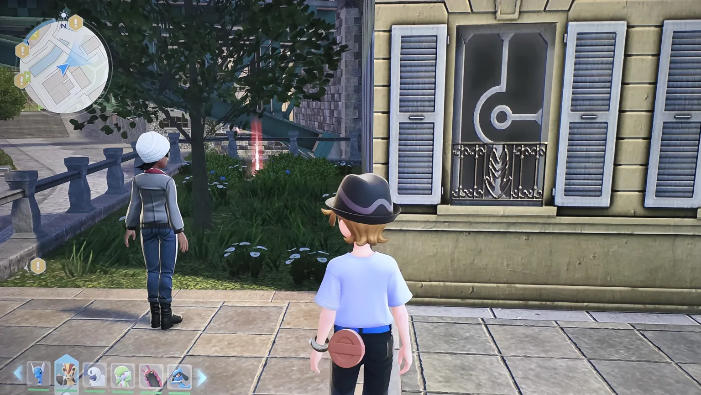

# Lumiose Atlas collectible locations

Field guide to item pickups and Colorful Screws photographed in Pokémon Legends: Z-A. Each find has its own entry with the in-game location, a landmark to look for, and the photographs used to identify it.

## Hyper Potion — Vert Sector 7 rooftop

On the in-game map, find the building beside **Vert Street** marked by the player arrow and red circle in the [sector view](../../assets/atlas/collectibles/vert-7-hyper-potion-rooftop/map-sector.webp). It is on the same side of Vert Street as the small garden with the looping path. Use the [close-up](../../assets/atlas/collectibles/vert-7-hyper-potion-rooftop/map-close.webp) to match the exact building outline.

From the roof shown in the gameplay photo, look across to the short, raised section of green metal roof beside the terrace with café tables and a cluster of pink crystals. The pickup ball is on that raised section, under the pink beam.

Trev identified the pickup as a Hyper Potion and surveyed the spot after unlocking Hover Glide. The gameplay photo shows the ball before collection. The route from street level, whether Hover Glide is required, and the exact coordinates on the Atlas basemap still need verification.

| Photo | What to look for | Source filename |
| --- | --- | --- |
| [Rooftop pickup](../../assets/atlas/collectibles/vert-7-hyper-potion-rooftop/pickup-rooftop.webp) | Pickup beam, green metal roof, café terrace and pink crystals | `1000029144.webp` |
| [Close map view](../../assets/atlas/collectibles/vert-7-hyper-potion-rooftop/map-close.webp) | The marked building outline and Vert Street label | `1000029145.webp` |
| [Sector map view](../../assets/atlas/collectibles/vert-7-hyper-potion-rooftop/map-sector.webp) | The same roof beside the garden and the Vert Sector 7 label | `1000029146.webp` |
| [Neighbourhood map view](../../assets/atlas/collectibles/vert-7-hyper-potion-rooftop/map-neighbourhood.webp) | The building in relation to the nearby Pokémon Center and surrounding blocks | `1000029143.webp` |

## Dive Ball — Vert Sector 7 rooftop

On the in-game map, find the canal-facing end of the building beside **Vert Street** in the [block view](../../assets/atlas/collectibles/vert-7-dive-ball-rooftop/map-block.webp). The [close-up](../../assets/atlas/collectibles/vert-7-dive-ball-rooftop/map-close.webp) shows where the player was standing. It is the same building outline as the Hyper Potion above, with the player marker closer to the canal.

On the flat, gray-tiled roof, look for the long chimney wall topped with two groups of dark pipes. The pink pickup beam is at the base of that wall. The [collection photo](../../assets/atlas/collectibles/vert-7-dive-ball-rooftop/pickup-confirmation.webp) shows the game awarding **Dive Ball ×1** next to the same chimney.

The route up from street level and the exact coordinates on the Atlas basemap still need verification.

| Photo | What to look for | Source filename |
| --- | --- | --- |
| [Rooftop pickup](../../assets/atlas/collectibles/vert-7-dive-ball-rooftop/pickup-rooftop.webp) | Pink beam at the base of the chimney wall | `1000029152.webp` |
| [Neighbourhood map view](../../assets/atlas/collectibles/vert-7-dive-ball-rooftop/map-neighbourhood.webp) | The surrounding canal, garden and street blocks | `1000029153.webp` |
| [Block map view](../../assets/atlas/collectibles/vert-7-dive-ball-rooftop/map-block.webp) | The building beside Vert Street and the canal | `1000029154.webp` |
| [Close map view](../../assets/atlas/collectibles/vert-7-dive-ball-rooftop/map-close.webp) | The player marker at the canal-facing end of the building | `1000029155.webp` |
| [Collection confirmation](../../assets/atlas/collectibles/vert-7-dive-ball-rooftop/pickup-confirmation.webp) | The on-screen award of one Dive Ball at the chimney | `1000029156.webp` |

## Potion — Vert Sector 7 staircase

Find the wide stone staircase beside the small garden with the looping path, between **Vert Street** and **Racine Construction**. The [neighbourhood map](../../assets/atlas/collectibles/vert-7-potion-staircase/map-neighbourhood.webp) shows the spot in relation to the Pokémon Center near Station Front. Use the [close map view](../../assets/atlas/collectibles/vert-7-potion-staircase/map-close.webp) to pick out the correct staircase.

Face up the steps and stay on the cobbled landing to their left. Walk past the black lamppost to the back corner, where the side wall of the stairs meets the dark stone retaining wall. The pickup beam is at ground level in that corner. The [collection photo](../../assets/atlas/collectibles/vert-7-potion-staircase/pickup-confirmation.webp) confirms **Potion ×1**.

The exact point on the Atlas basemap still needs verification for a live pin.

| Photo | What to look for | Source filename |
| --- | --- | --- |
| [Pickup beside the stairs](../../assets/atlas/collectibles/vert-7-potion-staircase/pickup-at-stairs.webp) | The wide steps, black lamppost and pickup beam in the back corner | `1000029162.webp` |
| [Wide map view](../../assets/atlas/collectibles/vert-7-potion-staircase/map-wide.webp) | The player's position in the wider Vert district | `1000029163.webp` |
| [Neighbourhood map view](../../assets/atlas/collectibles/vert-7-potion-staircase/map-neighbourhood.webp) | Vert Street, Racine Construction and the nearby Pokémon Center | `1000029164.webp` |
| [Close map view](../../assets/atlas/collectibles/vert-7-potion-staircase/map-close.webp) | The steps beside the small garden in Vert Sector 7 | `1000029165.webp` |
| [Collection confirmation](../../assets/atlas/collectibles/vert-7-potion-staircase/pickup-confirmation.webp) | The on-screen award of one Potion at the foot of the wall | `1000029166.webp` |

## Rare Candy — Vert Sector 7 by Coulant Waterway

On the in-game map, find **Café Cyclone** and the nearby crossing over **Coulant Waterway**. The [close map view](../../assets/atlas/collectibles/vert-7-rare-candy-waterway/map-close.webp) shows the player beside the building at the Vert Sector 7 end of the crossing.

From the paved walkway beside the pale shutters, step into the flower bed between the building and the stone railing. Look just past the tree, among the blue and white flowers toward the green steel bridge supports. The [collection photo](../../assets/atlas/collectibles/vert-7-rare-candy-waterway/pickup-confirmation.webp) confirms **Rare Candy ×1** in that flower bed.

The exact point on the Atlas basemap still needs verification for a live pin.

| Photo | What to look for | Source filename |
| --- | --- | --- |
| [Pickup in the flower bed](../../assets/atlas/collectibles/vert-7-rare-candy-waterway/pickup-in-flower-bed.webp) | The tree, shuttered windows, stone railing and pink pickup beam | `1000029172.webp` |
| [Wide map view](../../assets/atlas/collectibles/vert-7-rare-candy-waterway/map-wide.webp) | The player's position in the wider Vert district | `1000029173.webp` |
| [Neighbourhood map view](../../assets/atlas/collectibles/vert-7-rare-candy-waterway/map-neighbourhood.webp) | Café Cyclone, Coulant Waterway, Vert Street and Racine Construction | `1000029174.webp` |
| [Close map view](../../assets/atlas/collectibles/vert-7-rare-candy-waterway/map-close.webp) | The building and flower bed by the crossing | `1000029175.webp` |
| [Collection confirmation](../../assets/atlas/collectibles/vert-7-rare-candy-waterway/pickup-confirmation.webp) | The on-screen award of one Rare Candy beside the steel bridge supports | `1000029176.webp` |

## Great Ball — Vert Sector 7 under the Coulant Waterway bridge

Find the **Coulant Waterway** crossing near **Café Cyclone**. The [close map view](../../assets/atlas/collectibles/vert-7-great-ball-under-bridge/map-close.webp) shows the player at the Vert Sector 7 end of the crossing, close to the Rare Candy flower bed above.

Go to the lower cobbled plaza beneath the green steel bridge. Facing the wide stone staircase from the plaza, look to its right, under the bridge beams. The pickup is in the inside corner where the two dark stone walls meet. The [collection photo](../../assets/atlas/collectibles/vert-7-great-ball-under-bridge/pickup-confirmation.webp) confirms **Great Ball ×1** in that corner.

The exact point on the Atlas basemap still needs verification for a live pin.

| Photo | What to look for | Source filename |
| --- | --- | --- |
| [Pickup beneath the bridge](../../assets/atlas/collectibles/vert-7-great-ball-under-bridge/pickup-under-bridge.webp) | Green steel beams, wide staircase and pickup beam in the stone corner | `1000029182.webp` |
| [Wide map view](../../assets/atlas/collectibles/vert-7-great-ball-under-bridge/map-wide.webp) | The crossing in the wider Vert district | `1000029183.webp` |
| [Neighbourhood map view](../../assets/atlas/collectibles/vert-7-great-ball-under-bridge/map-neighbourhood.webp) | Café Cyclone, Coulant Waterway, Vert Street and Racine Construction | `1000029184.webp` |
| [Close map view](../../assets/atlas/collectibles/vert-7-great-ball-under-bridge/map-close.webp) | The player marker at the Vert Sector 7 end of the crossing | `1000029185.webp` |
| [Collection confirmation](../../assets/atlas/collectibles/vert-7-great-ball-under-bridge/pickup-confirmation.webp) | The on-screen award of one Great Ball where the stone walls meet | `1000029186.webp` |

## Potion — Vert Sector 7 raised walkway by Coulant Waterway

Find **Café Cyclone** and the crossing over **Coulant Waterway**. At the Vert Sector 7 end of the crossing, locate the building overlooking the construction scaffolding. The close in-game map photograph places the player on the walkway beside the building, east of Café Cyclone.

On the raised cobbled walkway alongside the pale building, walk towards the end of the stone railing overlooking the lower plaza. Look for the red pickup beam beside the low stone parapet, facing the black scaffolding towers with yellow ladders and an arrow-marked ramp. The final gameplay photograph confirms **Potion ×1** at this spot. This is a separate pickup from the ground-level staircase Potion above.

The route onto the raised walkway, any movement prerequisites, and the exact point on the Atlas basemap still need verification. Do not publish a live pin from the player marker alone.

**Evidence status:** All five supplied photographs were visually reviewed and decoded at 1536 × 865. Although the supplied filenames end in `.jpg`, the actual files are WebP. Their original bytes have been preserved for transfer. GitHub binary upload is pending; the following filenames identify the evidence and planned repository destination, not existing image links.

Destination: `assets/atlas/collectibles/vert-7-potion-raised-walkway/`.

| Photo | What to look for | Source filename | Destination filename |
| --- | --- | --- | --- |
| Pickup on raised walkway | Red pickup beam, low stone parapet, scaffolding and yellow ladders | `1000029192.jpg` | `pickup-on-walkway.webp` |
| Wide map view | Position within the wider Vert district | `1000029193.jpg` | `map-wide.webp` |
| Neighbourhood map view | Café Cyclone, Coulant Waterway, Vert Sector 6 and Vert Sector 7 | `1000029194.jpg` | `map-neighbourhood.webp` |
| Close map view | Player marker beside the building at the crossing | `1000029195.jpg` | `map-close.webp` |
| Collection confirmation | On-screen award of one Potion beside the scaffolding | `1000029196.jpg` | `pickup-confirmation.webp` |

## Potion — Vert Sector 7 scaffold planter by Coulant Waterway

Use the in-game map to locate **Café Cyclone** and the **Coulant Waterway** crossing. The three map photographs show the player close to the crossing, east of the café, near the lower construction plaza.

On the lower paved plaza beneath the green steel bridge, locate the tall black scaffolding tower next to a stone balustrade. Beside the tower is a narrow planted border with grass and a large round shrub. The red pickup beam is at ground level in the planting, immediately beside the shrub and stone corner post. The wide staircase opposite and overhead bridge provide additional visual landmarks. The final gameplay photograph confirms **Potion ×1** beside that shrub.

This is a separate pickup from the staircase Potion and raised-walkway Potion above. Another visible pickup beam on the nearby scaffold platform is not identified by this evidence and must not be catalogued as this Potion. The photographs were taken at night; a nighttime-only requirement has not been established. The precise Atlas basemap coordinate and access route from street level remain to be verified before publishing a live marker.

**Evidence status:** All five photographs were visually reviewed and decoded as genuine WebP images (1536 × 865, except the close map at 1536 × 831). Original bytes were preserved without re-encoding. GitHub binary upload is pending; the following are planned destinations, not existing image links.

Destination: `assets/atlas/collectibles/vert-7-potion-scaffold-planter/`.

| Photo | What to look for | Source filename | Destination filename |
| --- | --- | --- | --- |
| Pickup in planted border | Red beam, round shrub, tall scaffolding tower and stone post | `1000029204.jpg` | `pickup-in-planted-border.webp` |
| Wide map view | Position in the wider Vert district | `1000029205.jpg` | `map-wide.webp` |
| Neighbourhood map view | Café Cyclone, Coulant Waterway, Vert Sector 6 and Vert Sector 7 | `1000029206.jpg` | `map-neighbourhood.webp` |
| Close map view | Player marker beside the waterway crossing | `1000029207.jpg` | `map-close.webp` |
| Collection confirmation | On-screen award of one Potion beside the round shrub | `1000029208.jpg` | `pickup-confirmation.webp` |

## Carbos — Vert Sector 7 scaffold platform by Coulant Waterway

Find **Café Cyclone** and **Coulant Waterway** on the in-game map. The three map views place the player just east of the café near the crossing and construction plaza.

On the lower paved plaza, identify the black scaffolding assembly with yellow ladders and an arrow-marked ramp. The red pickup beam is on the raised side platform extending from the taller scaffold tower beside the tall yellow ladder and traffic cone, in front of the stone retaining wall. The final gameplay photograph shows the player standing on a platform and the award **Carbos ×1**. This is consistent with the previously unidentified elevated pickup beam visible in the scaffold-planter Potion evidence; it is a separate pickup from that Potion.

The photographs establish the pickup position and item identity. The exact climb sequence, any movement prerequisites, and the precise Atlas basemap coordinate remain unverified. Photographed at night; no nighttime-only requirement is established.

**Evidence status:** Five genuine WebP photographs decoded and visually reviewed, with original bytes preserved (1536 × 865 except the wide map at 1536 × 842). Binary upload to GitHub is pending; the following are planned destinations, not live image links.

Destination: `assets/atlas/collectibles/vert-7-carbos-scaffold-platform/`.

| Photo | What to look for | Source filename | Destination filename |
| --- | --- | --- | --- |
| Pickup on scaffold | Red beam, raised side platform, traffic cone and tall yellow ladder | `1000029216.jpg` | `pickup-on-scaffold.webp` |
| Wide map view | Position in the wider Vert district | `1000029217.jpg` | `map-wide.webp` |
| Neighbourhood map view | Café Cyclone, Coulant Waterway and Vert Sectors 6–7 | `1000029218.jpg` | `map-neighbourhood.webp` |
| Close map view | Player marker beside the waterway | `1000029219.jpg` | `map-close.webp` |
| Collection confirmation | On-screen award of one Carbos from the scaffold platform | `1000029220.jpg` | `pickup-confirmation.webp` |

## Colorful Screw — Vert Sector 7 covered scaffold by Coulant Waterway

Field catalogue find 009; Colorful Screw 001 in this photographic collection (not an official in-game numbering scheme).

Find **Café Cyclone** and the nearby **Coulant Waterway** bridge on the in-game map. The three map photographs place the player near the crossing east of the café.

Climb to the upper scaffolding platform with a yellow ladder opening. Face the covered scaffold tower beside the green steel bridge, identifiable by its patterned canopy and the purple collectible beam. Cross the narrow metal beam connecting the platforms. The screw sits on the elevated platform underneath the canopy, overlooking the waterway. The final gameplay photograph confirms **Colorful Screw ×1** on that platform. It is a separate collectible from the Carbos on the lower scaffold platform and the Potion in the planted border.

The photographed beam crossing and pickup position are established; the full climb from ground level, any movement prerequisites, and the exact Atlas basemap coordinate remain unverified. Photographed at night; no nighttime-only requirement is established. Do not publish a live marker until the basemap coordinate is checked.

**Evidence status:** Five genuine WebP photographs visually reviewed and decoded at 1536 × 865. Original bytes preserved and checked byte-for-byte in the local upload archive. Binary upload to GitHub remains pending; the following are planned destinations, not live image links.

Destination: `assets/atlas/collectibles/vert-7-colorful-screw-covered-scaffold/`.

| Photo | What to look for | Source filename | Destination filename |
| --- | --- | --- | --- |
| Pickup on covered platform | Purple beam, narrow metal crossing, scaffold canopy and bridge | `1000029226.jpg` | `pickup-on-covered-platform.webp` |
| Wide map view | Position within the wider Vert district | `1000029227.jpg` | `map-wide.webp` |
| Neighbourhood map view | Café Cyclone, Coulant Waterway and surrounding Vert sectors | `1000029228.jpg` | `map-neighbourhood.webp` |
| Close map view | Player marker near the crossing; distinguish player position from the pickup across the beam | `1000029229.jpg` | `map-close.webp` |
| Collection confirmation | On-screen award of one Colorful Screw beneath the canopy | `1000029230.jpg` | `pickup-confirmation.webp` |

## Pearl — Coulant Waterway east-bank tree planter near Vert Sector 6

Field catalogue find 010.

Locate **Café Cyclone**, then follow **Coulant Waterway** north-east towards the bridge beside **Vert Sector 6**. The close in-game map shows the player immediately east of the canal, south of that bridge; the wider map gives context relative to Vert Plaza and Wild Zone 11.

On the lower cobbled promenade, face the broad stairs leading towards the green-lit area. The planted strip along the canal's stone balustrade contains round shrubs, flowers and trees. Look for the red pickup beam at the foot of the nearer tree, among the flowers. The final gameplay photograph confirms **Pearl ×1** beside that tree. The other red beams farther towards the steps and across the canal are distinct pickups whose identities are not established by this batch.

The location is on the canal-side boundary near Vert Sector 6, rather than the earlier scaffold cluster. The exact sector boundary designation and Atlas basemap coordinate remain unverified. Photographed at night; no nighttime-only requirement is established.

**Evidence status:** All five original WebP photographs decoded at 1536 × 865 and visually reviewed. Their exact bytes are preserved and verified in the local upload archive. GitHub binary transfer remains pending; these are planned destinations, not live links.

Destination: `assets/atlas/collectibles/coulant-waterway-pearl-tree/`.

| Photo | What to look for | Source filename | Destination filename |
| --- | --- | --- | --- |
| Pickup by tree | Red beam at the foot of the nearer tree beside the canal balustrade | `1000029236.jpg` | `pickup-by-tree.webp` |
| Wide map view | Wider Vert district and Wild Zones 2 and 11 | `1000029237.jpg` | `map-wide.webp` |
| Neighbourhood map view | Café Cyclone, Coulant Waterway and Vert Sector 6 | `1000029238.jpg` | `map-neighbourhood.webp` |
| Close map view | Player on the east bank just south of the bridge | `1000029239.jpg` | `map-close.webp` |
| Collection confirmation | On-screen award of one Pearl beside the tree and white flowers | `1000029240.jpg` | `pickup-confirmation.webp` |

## Revive — Coulant Waterway east-bank staircase planter near Vert Sector 6

Field catalogue find 011.

Follow the lower east-bank promenade of **Coulant Waterway** towards **Vert Sector 6** and the wide staircase. The close map shows the player on the east bank of the canal, north of the nearby bridge. This is a different location from the Pearl farther south.

Facing the staircase, look in the planted strip on the left beside the canal balustrade. The approach photo shows a red pickup beam farther along the strip near the staircase, beyond the foreground pink crystals and shrubs. The final photo confirms **Revive ×1** beside the round shrub, flowers and stepped stone planters at the foot of the staircase. The pink crystals in the approach photograph are not the Revive.

The exact point on the Atlas basemap and sector boundary designation remain unverified. No live marker added.

**Evidence status:** All five supplied photographs decoded as genuine WebP images and visually reviewed. Original bytes verified in the local upload archive. GitHub binary transfer remains pending; these are planned destinations, not live links.

Destination: `assets/atlas/collectibles/coulant-waterway-revive-east-bank-stairs/`.

| Photo | What to look for | Source filename | Destination filename |
| --- | --- | --- | --- |
| Staircase planter approach | Red pickup beam in the planted strip near the stairs, beyond the foreground crystals | `1000029246.jpg` | `pickup-by-stair-planter.webp` |
| Wide map view | Wider Vert district and Wild Zones 2 and 11 | `1000029247.jpg` | `map-wide.webp` |
| Neighbourhood map view | Café Cyclone, Coulant Waterway and Vert Sector 6 | `1000029248.jpg` | `map-neighbourhood.webp` |
| Close map view | Player on the east side of the canal north of the bridge | `1000029249.jpg` | `map-close.webp` |
| Collection confirmation | On-screen award of one Revive beside the shrub and stepped planters | `1000029250.jpg` | `pickup-confirmation.webp` |

## Potion — Coulant Waterway west-bank stone recess near Vert Sector 3

Field catalogue find 012; a fourth distinct Potion pickup in this photographic collection.

From **Café Cyclone**, follow the lower western canal-side path towards **Vert Sector 3**, keeping the water to your right. The close map places the player west of the waterway and north of the crossing, opposite Vert Sector 6.

Look for the stone building wall with an arched window and a square planter, immediately beside a staircase. The red pickup beam is at ground level in the recessed inside corner of the wall to the left of the staircase. The last gameplay photo confirms **Potion ×1** in that stone corner. This is distinct from the previously documented Vert Sector 7 staircase, raised walkway and scaffold planter Potions.

The map shows the player's nearby position, not a calibrated collectible coordinate. The exact Atlas basemap point and sector boundary designation remain unverified. No live marker added.

**Evidence status:** Use only the five replacement photographs below, as requested by the contributor. The superseded HEIC batch is excluded. All five replacements decoded as genuine WebP images and their original bytes verified in the local upload archive. GitHub binary transfer remains pending; these are planned destinations, not live links.

Destination: `assets/atlas/collectibles/coulant-waterway-potion-west-bank-recess/`.

| Photo | What to look for | Source filename | Destination filename |
| --- | --- | --- | --- |
| Wall recess approach | Red pickup beam in the inside stone corner immediately left of the stairs | `1000029256.jpg` | `pickup-in-wall-recess.webp` |
| Wide map view | Wider Vert district | `1000029257.jpg` | `map-wide.webp` |
| Neighbourhood map view | Vert Sectors 3 and 6, Café Cyclone and Coulant Waterway | `1000029258.jpg` | `map-neighbourhood.webp` |
| Close map view | Player on the west side of the canal north of the crossing | `1000029259.jpg` | `map-close.webp` |
| Collection confirmation | On-screen award of one Potion in the stone recess | `1000029260.jpg` | `pickup-confirmation.webp` |

## Super Potion — Coulant Waterway west-bank tree planter near Vert Sector 3

Field catalogue find 013.

Locate **Coulant Waterway** between **Vert Sector 3** and **Vert Sector 6**. The close map photograph places the player near the northern end of the canal section, on its western edge beside the stairs and south of Wild Zone 11.

On the canal-side staircase landing, face along the waterway towards Café Cyclone. Look in the planted border beside the stone balustrade for the red pickup beam between the near tree and the round shrub, among the red flowers. The final gameplay photograph confirms **Super Potion ×1** beside the same tree. This is distinct from the Potion in the stone wall recess on the western bank and from the Pearl and Revive on the eastern bank.

The map indicates the player's nearby position, not a calibrated collectible coordinate. The precise Atlas basemap point and sector boundary designation remain unverified. No live marker added.

**Evidence status:** Five genuine WebP photographs visually reviewed and decoded, with dimensions ranging from 1536 × 776 to 1536 × 865. Their original bytes were verified in the local upload archive. Binary transfer to GitHub is pending; these are planned destinations, not live links.

Destination: `assets/atlas/collectibles/coulant-waterway-super-potion-west-bank-tree/`.

| Photo | What to look for | Source filename | Destination filename |
| --- | --- | --- | --- |
| Pickup by tree | Red beam between the tree and rounded shrub on the canal-side landing | `1000029266.jpg` | `pickup-by-tree.webp` |
| Wide map view | Wider Vert district and Wild Zones 2 and 11 | `1000029267.jpg` | `map-wide.webp` |
| Neighbourhood map view | Café Cyclone, Vert Sectors 3 and 6, Coulant Waterway | `1000029268.jpg` | `map-neighbourhood.webp` |
| Close map view | Player near the northern end of the canal on its western edge | `1000029269.jpg` | `map-close.webp` |
| Collection confirmation | On-screen award of one Super Potion by the tree | `1000029270.jpg` | `pickup-confirmation.webp` |

## Antidote — Vert Sector 3 upper terrace overlooking Wild Zone 11

Field catalogue find 014.

Locate **Vert Sector 3** on the map, immediately west of **Wild Zone 11 (Jaune Sector 10)** and south of **Saison Canal**. The close map places the player near the northeastern corner of Vert Sector 3, just outside the western green boundary of the wild zone.

Follow the upper cobbled terrace beside the wild zone. Look for wooden benches, a black lamppost by the stair opening and a square planter containing a small tree. The red pickup beam is in the far corner beside the planter where the stone parapet turns, overlooking the water and grassy terraces of Wild Zone 11. The final gameplay photograph confirms **Antidote ×1** at this corner, outside the wild zone. Do not confuse it with the other pickup beam visible below in the wild zone.

The precise Atlas basemap coordinate and any access prerequisites remain unverified. No live marker added.

**Evidence status:** Five genuine WebP photographs decoded and visually reviewed, with dimensions ranging from 1536 × 793 to 1536 × 865. Original bytes were verified against all five files in the local upload archive. GitHub binary transfer remains pending; these are planned destinations, not live links.

Destination: `assets/atlas/collectibles/vert-3-antidote-wild-zone-11-terrace/`.

| Photo | What to look for | Source filename | Destination filename |
| --- | --- | --- | --- |
| Pickup by terrace planter | Red beam beside the benches, square planter and parapet | `1000029276.jpg` | `pickup-by-terrace-planter.webp` |
| Wide map view | Vert district and Wild Zones 2 and 11 | `1000029277.jpg` | `map-wide.webp` |
| Neighbourhood map view | Vert Sector 3, Saison Canal and Jaune Sector 10 | `1000029278.jpg` | `map-neighbourhood.webp` |
| Close map view | Player near the western boundary of Wild Zone 11 | `1000029279.jpg` | `map-close.webp` |
| Collection confirmation | On-screen award of one Antidote beside the terrace planter | `1000029280.jpg` | `pickup-confirmation.webp` |

## Super Potion — Vert Sector 3 Wild Zone 11 balustrade

Field catalogue find 015; the second distinct Super Potion in this photographic collection.

Locate **Vert Sector 3** immediately west of **Wild Zone 11 (Jaune Sector 10)**. The three in-game map photographs show the player along the western green boundary of the wild zone, slightly south of the earlier Antidote terrace location.

Follow the paved promenade alongside the wild-zone boundary. Look for the stone balustrade between two square wooden planters containing small trees. The red pickup beam stands directly on the pavement beside the railing, opposite the lower grassy area near the green Wild Zone 11 entrance pillars. The final gameplay photograph confirms **Super Potion ×1** beside this balustrade. The red pickup beam visible below inside the wild zone is a different, unidentified item. This Super Potion is distinct from the west-bank tree-planter Super Potion in find 013 and from the Antidote in find 014.

The photographs establish the item identity and pickup position relative to the railing. The precise Atlas basemap coordinate and any access prerequisites remain unverified. No live marker added.

**Evidence status:** Five genuine WebP photographs decoded and visually reviewed (1536 pixels wide, heights 806–865 pixels). Original bytes verified against all five files in the cumulative local upload archive. GitHub binary transfer remains pending; these are planned destinations, not live image links.

Destination: `assets/atlas/collectibles/vert-3-super-potion-wild-zone-11-balustrade/`.

| Photo | What to look for | Source filename | Destination filename |
| --- | --- | --- | --- |
| Pickup beside balustrade | Red beam on the pavement between two square planters, outside the railing | `1000029287.jpg` | `pickup-by-balustrade.webp` |
| Wide map view | Wider Vert district and Wild Zones 2 and 11 | `1000029288.jpg` | `map-wide.webp` |
| Neighbourhood map view | Vert Sector 3, Saison Canal and Jaune Sector 10 | `1000029289.jpg` | `map-neighbourhood.webp` |
| Close map view | Player beside the western Wild Zone 11 boundary | `1000029290.jpg` | `map-close.webp` |
| Collection confirmation | On-screen award of one Super Potion at the railing | `1000029291.jpg` | `pickup-confirmation.webp` |

## Dusk Ball — Vert Sector 3 lower Saison Canal promenade by lamppost

Field catalogue find 016.

Locate **Saison Canal** immediately north of **Vert Sector 3** and west of **Wild Zone 11 (Jaune Sector 10)**. The three map photographs place the player near the southeastern edge of Saison Canal, on the southern bank just west of the wild-zone boundary.

Descend to the lower cobbled canal-side promenade near the western boundary of Wild Zone 11. Face along the canal towards the stone arched bridge and Prism Tower, keeping the water and black railing on the right and the stone retaining wall with ivy on the left. The approach photograph shows the red pickup beam at the foot of the first ornate black lamppost. The final gameplay photograph confirms **Dusk Ball ×1** beside that lamppost. The nearby pedestrian is an incidental visual reference, not a required encounter.

The photographs establish item identity, level and pickup position relative to the lamppost. The map marker records the player's nearby position, not a calibrated collectible coordinate. The precise Atlas basemap point remains unverified. No live marker added.

**Evidence status:** All five original photographs decoded as genuine WebP (1536 pixels wide, heights 834–865 pixels). Their bytes were compared against the new cumulative archive, and the existing 50 archived photographs were verified unchanged. GitHub binary transfer remains pending; these are planned destinations, not live image links.

Destination: `assets/atlas/collectibles/vert-3-dusk-ball-saison-canal-lamppost/`.

| Photo | What to look for | Source filename | Destination filename |
| --- | --- | --- | --- |
| Pickup by lamppost | Red beam at foot of black lamppost on lower canal promenade | `1000029298.jpg` | `pickup-by-lamppost.webp` |
| Wide map view | Wider Vert district and Wild Zones 2 and 11 | `1000029299.jpg` | `map-wide.webp` |
| Neighbourhood map view | Saison Canal, Vert Sector 3 and Jaune Sector 10 | `1000029300.jpg` | `map-neighbourhood.webp` |
| Close map view | Player on southern canal bank just west of Wild Zone 11 | `1000029301.jpg` | `map-close.webp` |
| Collection confirmation | On-screen award of one Dusk Ball beside the lamppost | `1000029302.jpg` | `pickup-confirmation.webp` |

## Revive — Vert Sector 3 raised Saison Canal walkway

Field catalogue find 017; the second distinct Revive in this photographic collection.

Locate **Saison Canal** immediately north of **Vert Sector 3**, west of **Wild Zone 11 (Jaune Sector 10)**. The three in-game map photographs place the player on the southern canal bank close to the bridge and staircase, farther west than the earlier Dusk Ball location.

Descend the broad stone staircase to the cobbled landing. Locate the slightly raised building-side walkway parallel to the lower waterfront promenade. Facing towards Wild Zone 11 with the canal on the left, look for the red pickup beam on the raised walkway in the corner between the building with blue windows and the projecting stone retaining wall. The final gameplay photograph confirms **Revive ×1** in that corner. This is distinct from the Revive beside the east-bank staircase planter on Coulant Waterway (find 011), and from the Dusk Ball on the lower Saison Canal promenade (find 016). Other visible pickup beams and pink crystals are not identified by this photo set.

The photographs establish item identity and elevation. The map views show the player's approach position, not a calibrated collectible coordinate. The exact Atlas basemap point and any special access requirements remain unverified. No live marker added.

**Evidence status:** All five original photographs decoded as genuine WebP (1536 pixels wide, heights 821–865 pixels). Original bytes verified against all five new files in the cumulative 60-photo upload archive, with all 55 earlier archived files confirmed unchanged. GitHub binary transfer remains pending; the following are planned destinations, not live image links.

Destination: `assets/atlas/collectibles/vert-3-revive-saison-canal-raised-walkway/`.

| Photo | What to look for | Source filename | Destination filename |
| --- | --- | --- | --- |
| Pickup in wall corner | Red beam on raised building-side walkway, beside projecting stone wall | `1000029308.jpg` | `pickup-in-wall-corner.webp` |
| Wide map view | Wider Vert district and Wild Zones 2 and 11 | `1000029309.jpg` | `map-wide.webp` |
| Neighbourhood map view | Saison Canal, Vert Sector 3 and Jaune Sector 10 | `1000029310.jpg` | `map-neighbourhood.webp` |
| Close map view | Player on southern bank near bridge and staircase | `1000029311.jpg` | `map-close.webp` |
| Collection confirmation | On-screen award of one Revive in the stone wall corner | `1000029312.jpg` | `pickup-confirmation.webp` |

## Burn Heal — Saison Canal bridge between Vert Sectors 1 and 3

Field catalogue find 018.

Locate the bridge over **Saison Canal** between **Vert Sector 1** and **Vert Sector 3**, west of Wild Zone 11. The three map photographs place the player near the southern end of this crossing, above the lower canal-side paths.

On the upper bridge, look for the red-brick paving, circular decorative pavement motifs and stone balustrades. The approach photograph shows a red pickup beam beside the balustrade towards the southern end of the crossing. The final gameplay photograph confirms **Burn Heal ×1** at that railing. The nearby pedestrians are incidental and not required for collection. This is a distinct upper-level pickup, not the Dusk Ball or Revive recorded on the lower and raised building-side promenades in finds 016 and 017.

The photographs establish the item identity and bridge-level position. The map views show the player's nearby position rather than a calibrated collectible coordinate. The precise Atlas basemap point remains unverified. No live marker added.

**Evidence status:** Five original photographs decoded as genuine WebP (1536 pixels wide, heights 826–865 pixels). All five files were verified byte-for-byte in the cumulative 65-photo archive, and all 60 previous archived files were verified unchanged. GitHub binary transfer remains pending; these are planned destinations, not live image links.

Destination: `assets/atlas/collectibles/saison-canal-burn-heal-bridge/`.

| Photo | What to look for | Source filename | Destination filename |
| --- | --- | --- | --- |
| Pickup beside bridge balustrade | Red beam beside stone railing on brick-paved bridge | `1000029318.jpg` | `pickup-by-bridge-balustrade.webp` |
| Wide map view | Bridge location relative to Vert Plaza and Wild Zone 11 | `1000029319.jpg` | `map-wide.webp` |
| Neighbourhood map view | Saison Canal and Vert Sectors 1 and 3 | `1000029320.jpg` | `map-neighbourhood.webp` |
| Close map view | Player near the southern end of the bridge | `1000029321.jpg` | `map-close.webp` |
| Collection confirmation | On-screen award of one Burn Heal at the stone balustrade | `1000029322.jpg` | `pickup-confirmation.webp` |

## Poké Ball — Vert Plaza northeast landscaped strip beside scaffolding

Field catalogue find 019.

Locate **Vert Plaza (Wild Zone 2)** and the route running between **Vert Sectors 1 and 3** towards the bridge over **Saison Canal**. The three in-game map photographs place the player near the southern end of the elongated landscaped strip, immediately northeast of Vert Plaza and outside the wild-zone boundary.

From Vert Plaza, head towards Saison Canal along this route. Look for the building covered in black construction scaffolding, with cyan-edged platforms and arrow-marked ramps. Beside the scaffolding is a grassy landscaped strip with trees, shrubs and flowers. The approach photograph shows a red pickup beam at the base of the nearer tree, beside flowering plants. The final gameplay photograph confirms **Poké Ball ×1** beside that tree. Nearby pink crystals and other visible sparkles are separate features, not this pickup.

The item is at ground level; the photographs do not establish any need to climb the scaffolding. The map views record the player's nearby position, not a calibrated collectible coordinate. The exact Atlas basemap point and formal sector designation remain unverified. No live marker added.

**Evidence status:** All five original photographs decoded as genuine WebP at 1536 × 865. Original bytes verified against all five new files in the cumulative 70-photo upload archive, with all 65 previous archived photographs confirmed unchanged. GitHub binary transfer remains pending; the following are planned destinations, not live image links.

Destination: `assets/atlas/collectibles/vert-plaza-poke-ball-scaffold-tree/`.

| Photo | What to look for | Source filename | Destination filename |
| --- | --- | --- | --- |
| Pickup by tree | Red beam at the tree base beside flowers and scaffolding | `1000029328.jpg` | `pickup-by-tree.webp` |
| Wide map view | Location relative to Wild Zones 2 and 11 | `1000029329.jpg` | `map-wide.webp` |
| Neighbourhood map view | Vert Plaza, Vert Sectors 1 and 3 and Saison Canal | `1000029330.jpg` | `map-neighbourhood.webp` |
| Close map view | Player at the southern end of the landscaped strip northeast of Vert Plaza | `1000029331.jpg` | `map-close.webp` |
| Collection confirmation | On-screen award of one Poké Ball beside the tree | `1000029332.jpg` | `pickup-confirmation.webp` |
