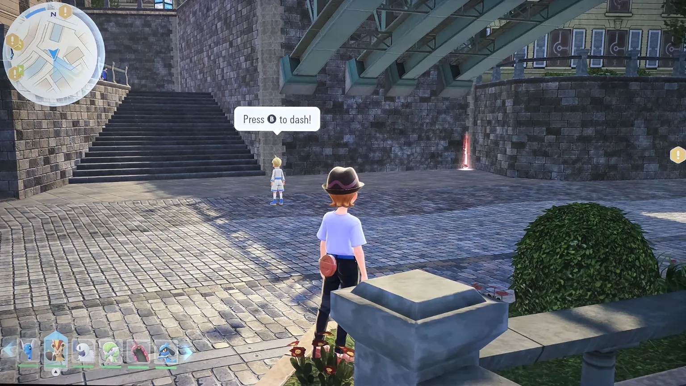

# Lumiose Atlas collectible locations

Field guide to item pickups and Colorful Screws photographed in Pokémon Legends: Z-A. Each find has its own entry with the in-game location, a landmark to look for, and the photographs used to identify it.

## Hyper Potion — Vert Sector 7 rooftop

On the in-game map, find the building beside **Vert Street** marked by the player arrow and red circle in the [sector view](../../assets/atlas/collectibles/vert-7-hyper-potion-rooftop/map-sector.webp). It is on the same side of Vert Street as the small garden with the looping path. Use the [close-up](../../assets/atlas/collectibles/vert-7-hyper-potion-rooftop/map-close.webp) to match the exact building outline.

From the roof shown in the gameplay photo, look across to the short, raised section of green metal roof beside the terrace with café tables and a cluster of pink crystals. The pickup ball is on that raised section, under the pink beam.

Trev identified the pickup as a Hyper Potion and surveyed the spot after unlocking Hover Glide. The gameplay photo shows the ball before collection. The route from street level, whether Hover Glide is required, and the exact coordinates on the Atlas basemap still need verification.

| Photo | What to look for | Source filename |
| --- | --- | --- |
| [Rooftop pickup](../../assets/atlas/collectibles/vert-7-hyper-potion-rooftop/pickup-rooftop.webp) | Pickup beam, green metal roof, café terrace and pink crystals | `1000029144.webp` |
| [Close map view](../../assets/atlas/collectibles/vert-7-hyper-potion-rooftop/map-close.webp) | The marked building outline and Vert Street label | `1000029145.webp` |
| [Sector map view](../../assets/atlas/collectibles/vert-7-hyper-potion-rooftop/map-sector.webp) | The same roof beside the garden and the Vert Sector 7 label | `1000029146.webp` |
| [Neighbourhood map view](../../assets/atlas/collectibles/vert-7-hyper-potion-rooftop/map-neighbourhood.webp) | The building in relation to the nearby Pokémon Center and surrounding blocks | `1000029143.webp` |

## Dive Ball — Vert Sector 7 rooftop

On the in-game map, find the canal-facing end of the building beside **Vert Street** in the [block view](../../assets/atlas/collectibles/vert-7-dive-ball-rooftop/map-block.webp). The [close-up](../../assets/atlas/collectibles/vert-7-dive-ball-rooftop/map-close.webp) shows where the player was standing. It is the same building outline as the Hyper Potion above, with the player marker closer to the canal.

On the flat, gray-tiled roof, look for the long chimney wall topped with two groups of dark pipes. The pink pickup beam is at the base of that wall. The [collection photo](../../assets/atlas/collectibles/vert-7-dive-ball-rooftop/pickup-confirmation.webp) shows the game awarding **Dive Ball ×1** next to the same chimney.

The route up from street level and the exact coordinates on the Atlas basemap still need verification.

| Photo | What to look for | Source filename |
| --- | --- | --- |
| [Rooftop pickup](../../assets/atlas/collectibles/vert-7-dive-ball-rooftop/pickup-rooftop.webp) | Pink beam at the base of the chimney wall | `1000029152.webp` |
| [Neighbourhood map view](../../assets/atlas/collectibles/vert-7-dive-ball-rooftop/map-neighbourhood.webp) | The surrounding canal, garden and street blocks | `1000029153.webp` |
| [Block map view](../../assets/atlas/collectibles/vert-7-dive-ball-rooftop/map-block.webp) | The building beside Vert Street and the canal | `1000029154.webp` |
| [Close map view](../../assets/atlas/collectibles/vert-7-dive-ball-rooftop/map-close.webp) | The player marker at the canal-facing end of the building | `1000029155.webp` |
| [Collection confirmation](../../assets/atlas/collectibles/vert-7-dive-ball-rooftop/pickup-confirmation.webp) | The on-screen award of one Dive Ball at the chimney | `1000029156.webp` |

## Potion — Vert Sector 7 staircase

Find the wide stone staircase beside the small garden with the looping path, between **Vert Street** and **Racine Construction**. The [neighbourhood map](../../assets/atlas/collectibles/vert-7-potion-staircase/map-neighbourhood.webp) shows the spot in relation to the Pokémon Center near Station Front. Use the [close map view](../../assets/atlas/collectibles/vert-7-potion-staircase/map-close.webp) to pick out the correct staircase.

Face up the steps and stay on the cobbled landing to their left. Walk past the black lamppost to the back corner, where the side wall of the stairs meets the dark stone retaining wall. The pickup beam is at ground level in that corner. The [collection photo](../../assets/atlas/collectibles/vert-7-potion-staircase/pickup-confirmation.webp) confirms **Potion ×1**.

The exact point on the Atlas basemap still needs verification for a live pin.

| Photo | What to look for | Source filename |
| --- | --- | --- |
| [Pickup beside the stairs](../../assets/atlas/collectibles/vert-7-potion-staircase/pickup-at-stairs.webp) | The wide steps, black lamppost and pickup beam in the back corner | `1000029162.webp` |
| [Wide map view](../../assets/atlas/collectibles/vert-7-potion-staircase/map-wide.webp) | The player's position in the wider Vert district | `1000029163.webp` |
| [Neighbourhood map view](../../assets/atlas/collectibles/vert-7-potion-staircase/map-neighbourhood.webp) | Vert Street, Racine Construction and the nearby Pokémon Center | `1000029164.webp` |
| [Close map view](../../assets/atlas/collectibles/vert-7-potion-staircase/map-close.webp) | The steps beside the small garden in Vert Sector 7 | `1000029165.webp` |
| [Collection confirmation](../../assets/atlas/collectibles/vert-7-potion-staircase/pickup-confirmation.webp) | The on-screen award of one Potion at the foot of the wall | `1000029166.webp` |

## Rare Candy — Vert Sector 7 by Coulant Waterway

On the in-game map, find **Café Cyclone** and the nearby crossing over **Coulant Waterway**. The [close map view](../../assets/atlas/collectibles/vert-7-rare-candy-waterway/map-close.webp) shows the player beside the building at the Vert Sector 7 end of the crossing.

From the paved walkway beside the pale shutters, step into the flower bed between the building and the stone railing. Look just past the tree, among the blue and white flowers toward the green steel bridge supports. The [collection photo](../../assets/atlas/collectibles/vert-7-rare-candy-waterway/pickup-confirmation.webp) confirms **Rare Candy ×1** in that flower bed.

The exact point on the Atlas basemap still needs verification for a live pin.

| Photo | What to look for | Source filename |
| --- | --- | --- |
| [Pickup in the flower bed](../../assets/atlas/collectibles/vert-7-rare-candy-waterway/pickup-in-flower-bed.webp) | The tree, shuttered windows, stone railing and pink pickup beam | `1000029172.webp` |
| [Wide map view](../../assets/atlas/collectibles/vert-7-rare-candy-waterway/map-wide.webp) | The player's position in the wider Vert district | `1000029173.webp` |
| [Neighbourhood map view](../../assets/atlas/collectibles/vert-7-rare-candy-waterway/map-neighbourhood.webp) | Café Cyclone, Coulant Waterway, Vert Street and Racine Construction | `1000029174.webp` |
| [Close map view](../../assets/atlas/collectibles/vert-7-rare-candy-waterway/map-close.webp) | The building and flower bed by the crossing | `1000029175.webp` |
| [Collection confirmation](../../assets/atlas/collectibles/vert-7-rare-candy-waterway/pickup-confirmation.webp) | The on-screen award of one Rare Candy beside the steel bridge supports | `1000029176.webp` |

## Great Ball — Vert Sector 7 under the Coulant Waterway bridge

Find the **Coulant Waterway** crossing near **Café Cyclone**. The [close map view](../../assets/atlas/collectibles/vert-7-great-ball-under-bridge/map-close.webp) shows the player at the Vert Sector 7 end of the crossing, close to the Rare Candy flower bed above.

Go to the lower cobbled plaza beneath the green steel bridge. Facing the wide stone staircase from the plaza, look to its right, under the bridge beams. The pickup is in the inside corner where the two dark stone walls meet. The [collection photo](../../assets/atlas/collectibles/vert-7-great-ball-under-bridge/pickup-confirmation.webp) confirms **Great Ball ×1** in that corner.

The exact point on the Atlas basemap still needs verification for a live pin.

| Photo | What to look for | Source filename |
| --- | --- | --- |
| [Pickup beneath the bridge](../../assets/atlas/collectibles/vert-7-great-ball-under-bridge/pickup-under-bridge.webp) | Green steel beams, wide staircase and pickup beam in the stone corner | `1000029182.webp` |
| [Wide map view](../../assets/atlas/collectibles/vert-7-great-ball-under-bridge/map-wide.webp) | The crossing in the wider Vert district | `1000029183.webp` |
| [Neighbourhood map view](../../assets/atlas/collectibles/vert-7-great-ball-under-bridge/map-neighbourhood.webp) | Café Cyclone, Coulant Waterway, Vert Street and Racine Construction | `1000029184.webp` |
| [Close map view](../../assets/atlas/collectibles/vert-7-great-ball-under-bridge/map-close.webp) | The player marker at the Vert Sector 7 end of the crossing | `1000029185.webp` |
| [Collection confirmation](../../assets/atlas/collectibles/vert-7-great-ball-under-bridge/pickup-confirmation.webp) | The on-screen award of one Great Ball where the stone walls meet | `1000029186.webp` |

## Potion — Vert Sector 7 raised walkway by Coulant Waterway

Find **Café Cyclone** and the crossing over **Coulant Waterway**. At the Vert Sector 7 end of the crossing, locate the building overlooking the construction scaffolding. The close in-game map photograph places the player on the walkway beside the building, east of Café Cyclone.

On the raised cobbled walkway alongside the pale building, walk towards the end of the stone railing overlooking the lower plaza. Look for the red pickup beam beside the low stone parapet, facing the black scaffolding towers with yellow ladders and an arrow-marked ramp. The final gameplay photograph confirms **Potion ×1** at this spot. This is a separate pickup from the ground-level staircase Potion above.

The route onto the raised walkway, any movement prerequisites, and the exact point on the Atlas basemap still need verification. Do not publish a live pin from the player marker alone.

**Evidence status:** All five supplied photographs were visually reviewed and decoded at 1536 × 865. Although the supplied filenames end in `.jpg`, the actual files are WebP. Their original bytes have been preserved for transfer. GitHub binary upload is pending; the following filenames identify the evidence and planned repository destination, not existing image links.

Destination: `assets/atlas/collectibles/vert-7-potion-raised-walkway/`.

| Photo | What to look for | Source filename | Destination filename |
| --- | --- | --- | --- |
| Pickup on raised walkway | Red pickup beam, low stone parapet, scaffolding and yellow ladders | `1000029192.jpg` | `pickup-on-walkway.webp` |
| Wide map view | Position within the wider Vert district | `1000029193.jpg` | `map-wide.webp` |
| Neighbourhood map view | Café Cyclone, Coulant Waterway, Vert Sector 6 and Vert Sector 7 | `1000029194.jpg` | `map-neighbourhood.webp` |
| Close map view | Player marker beside the building at the crossing | `1000029195.jpg` | `map-close.webp` |
| Collection confirmation | On-screen award of one Potion beside the scaffolding | `1000029196.jpg` | `pickup-confirmation.webp` |

## Potion — Vert Sector 7 scaffold planter by Coulant Waterway

Use the in-game map to locate **Café Cyclone** and the **Coulant Waterway** crossing. The three map photographs show the player close to the crossing, east of the café, near the lower construction plaza.

On the lower paved plaza beneath the green steel bridge, locate the tall black scaffolding tower next to a stone balustrade. Beside the tower is a narrow planted border with grass and a large round shrub. The red pickup beam is at ground level in the planting, immediately beside the shrub and stone corner post. The wide staircase opposite and overhead bridge provide additional visual landmarks. The final gameplay photograph confirms **Potion ×1** beside that shrub.

This is a separate pickup from the staircase Potion and raised-walkway Potion above. Another visible pickup beam on the nearby scaffold platform is not identified by this evidence and must not be catalogued as this Potion. The photographs were taken at night; a nighttime-only requirement has not been established. The precise Atlas basemap coordinate and access route from street level remain to be verified before publishing a live marker.

**Evidence status:** All five photographs were visually reviewed and decoded as genuine WebP images (1536 × 865, except the close map at 1536 × 831). Original bytes were preserved without re-encoding. GitHub binary upload is pending; the following are planned destinations, not existing image links.

Destination: `assets/atlas/collectibles/vert-7-potion-scaffold-planter/`.

| Photo | What to look for | Source filename | Destination filename |
| --- | --- | --- | --- |
| Pickup in planted border | Red beam, round shrub, tall scaffolding tower and stone post | `1000029204.jpg` | `pickup-in-planted-border.webp` |
| Wide map view | Position in the wider Vert district | `1000029205.jpg` | `map-wide.webp` |
| Neighbourhood map view | Café Cyclone, Coulant Waterway, Vert Sector 6 and Vert Sector 7 | `1000029206.jpg` | `map-neighbourhood.webp` |
| Close map view | Player marker beside the waterway crossing | `1000029207.jpg` | `map-close.webp` |
| Collection confirmation | On-screen award of one Potion beside the round shrub | `1000029208.jpg` | `pickup-confirmation.webp` |
